# 🎓 HỌC VIỆN CÔNG NGHỆ BƯU CHÍNH VIỄN THÔNG (PTIT)
## Đồ Án Kết Thúc Học Phần: Lập Trình Mạng — Hệ Thống Quản Lý Đào Tạo Tín Chỉ & Sinh Viên Phân Tán Qua Giao Thức Mạng RUDP 2.0, Bảo Mật Đa Lớp (DES / AES-256-GCM / HMAC-SHA256) & Cơ Sở Dữ Liệu Đám Mây Supabase PostgreSQL

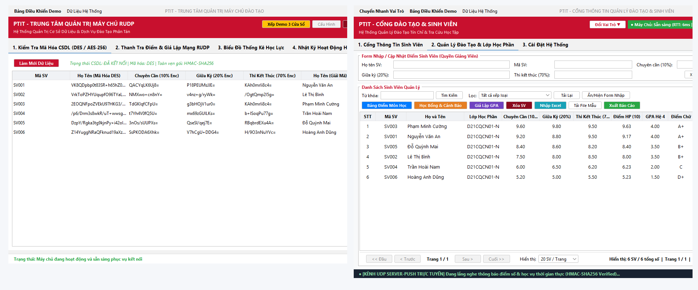

Hệ thống ứng dụng Quản lý Đào tạo Tín chỉ & Sinh viên phân tán Client – Server viết bằng ngôn ngữ **Java (JDK 21 / Swing FlatLaf)**, truyền nhận gói tin thời gian thực qua giao thức **RUDP 2.0 (Reliable UDP trên nền `DatagramSocket`)**, tích hợp động cơ mã hóa đối xứng kép **DES (56-bit) & AES-256-GCM**, ký số toàn vẹn từng gói tin bằng **HMAC-SHA256**, kênh thông báo đẩy hai chiều **Full-Duplex UDP Server-Push**, lưu trữ trên **Cơ sở dữ liệu Đám mây Supabase Cloud PostgreSQL (`HikariCP` + `H2 Embedded Auto-Fallback`)**, kiểm soát phân quyền **RBAC (Sinh viên / Giảng viên / Quản trị viên)** và báo cáo **Excel (`.xlsx` Apache POI)**.

---

## 👥 DANH SÁCH THÀNH VIÊN NHÓM 2 & BẢNG PHÂN CÔNG NHIỆM VỤ (KHÔNG XUNG ĐỘT FILE/TÍNH NĂNG)

- **Nhóm thực hiện:** **Nhóm 2** (`D24TXCN01-N` / `D24TXCNPM01-N`)
- **Nguyên tắc phân chia:** Mỗi thành viên phụ trách trọn vẹn một gói chức năng (`package` / `class`) độc lập, không đụng chạm hoặc xung đột code (`merge conflict`) với nhau. **Nhóm trưởng Phạm Công Thành (`N24DTCN079`)** đảm nhận phần lõi kỹ thuật mạng và mật mã học lớn nhất (**35%**), **5 thành viên còn lại** chia đều nhau (**13% / người**, tổng $35\% + 5 \times 13\% = 100\%$).
- **Hồ sơ báo cáo toàn văn 4 Chương:** [`docs/BAO_CAO_DO_AN_KET_THUC_MON.md`](./docs/BAO_CAO_DO_AN_KET_THUC_MON.md)

| STT | Mã Sinh Viên | Họ và Tên | Lớp | Vai Trò & Phân Hệ Độc Lập | Các File Code & Tính Năng Cụ Thể Đảm Nhận (Tách Biệt 100% Tránh Xung Đột) | Tỷ Trọng | Điểm Đóng Góp |
| :-: | :---: | :--- | :---: | :---: | :--- | :-: | :-: |
| **1** | **N24DTCN079** | **Phạm Công Thành** | `D24TXCN01-N` | **Nhóm Trưởng**<br>*(Giao Thức Mạng RUDP 2.0, Bảo Mật Đa Lớp & Điều Phối Server)* | • **Package `network` & `server` (`UDPPacket.java`, `PacketType.java`, `UDPServer.java`, `UDPClient.java`, `SessionManager.java`, `AppLauncher.java`)**: Thiết kế giao thức **RUDP 2.0** (`Seq/ACK`, truyền lại tự động `Stop-and-Wait ARQ` với `Exponential Backoff`, bộ đệm chống trùng gói `Idempotent LRU Cache`, nén `GZIP`, truyền tệp đề cương phân mảnh `Chunked File Stream SHA-256`, xử lý đa luồng `ThreadPoolExecutor 20 workers` và kênh đẩy thời gian thực `Full-Duplex UDP Server-Push`).<br>• **Package `security` (`SecurityManager.java`, `DESEncryption.java`, `AESEncryption.java`)**: Động cơ mã hóa kép `DES 56-bit` (kiểm chứng khóa 8-byte & bắt lỗi `BadPaddingException` trực tiếp trên UI) & `AES-256-GCM (PBKDF2)`, chữ ký số gói tin `HMAC-SHA256`, chống `Replay Attack`, **Xoay khóa & Tái mã hóa toàn bộ CSDL trực tuyến (`Live Key Rotation`)**, Sao lưu & Khôi phục Snapshot xác thực chữ ký `HMAC-SHA256`.<br>• **Phòng thí nghiệm Mạng (`ServerGUI.java`)**: `Network Chaos Simulator` (giả lập rớt gói 0–60%, độ trễ 0–300ms) và công cụ **Đo kiểm chịu tải đa luồng RUDP (`50 gói song song / 5 luồng`)**. | **35%** | **10.0 / 10 (100% + Điểm cộng)** |
| **2** | **N24DTCN042** | **Hồ Quốc Khải** | `D24TXCN01-N` | Thành viên<br>*(Hạ Tầng Kết Nối CSDL Cloud, Docker & DAO Sinh Viên)* | • **Package `database` (`DatabaseManager.java`, `ConnectionPool.java`, `DatabaseConfigLoader.java`, `SqlConfig.java`, `docker-compose.yml`, `init.sql`)**: Quản lý kết nối `Supabase Cloud PostgreSQL` qua `HikariCP Connection Pool`, cơ chế tự động chuyển đổi dự phòng (`Auto-Fallback`) sang `H2 Embedded` và cấu hình Docker `MySQL 8.0`.<br>• **Tầng DAO Sinh viên (`StudentDAO.java`, `SubjectDAO.java`)**: Truy vấn CRUD hồ sơ sinh viên mã hóa, phân trang SQL (`LIMIT / OFFSET`) và giao dịch Batch Transaction ACID trên 1 kết nối vật lý duy nhất. | **13%** | **9.0 / 10 (90%)** |
| **3** | **N24DTCN017** | **Dương Trung Dũng** | `D24TXCN01-N` | Thành viên<br>*(Xác Thực Tài Khoản RBAC & Nhật Ký Thanh Tra Điểm)* | • **Xác thực & Băm mật khẩu (`AccountDAO.java`, `PasswordHasher.java`, `UserAccount.java`)**: Cơ chế băm mật khẩu một chiều `SHA-256 + Salt`, kiểm soát phân quyền 3 vai trò `ADMIN / TEACHER / STUDENT` và hộp thoại đăng nhập xác thực.<br>• **Nhật ký Thanh tra Bất biến (`AuditDAO.java` & Bảng Thanh tra trên `ServerGUI.java`)**: Tự động đối chiếu và ghi vết lịch sử sửa điểm (`Điểm cũ -> Điểm mới`), tài khoản thực hiện, địa chỉ IP và thời gian. | **13%** | **9.0 / 10 (90%)** |
| **4** | **N24DTCN050** | **Cao Thành Long** | `D24TXCN01-N` | Thành viên<br>*(Nghiệp Vụ Điểm Tín Chỉ & Phân Hệ Quản Lý Giảng Viên)* | • **Mô hình & DAO Bảng điểm Tín chỉ (`StudentResult.java`, `CourseGrade.java`, `StudentTranscript.java`, `TranscriptDAO.java`)**: Công thức trọng số `10% Chuyên cần + 20% Giữa kỳ + 70% Thi kết thúc`, quy đổi đồng nhất GPA hệ 4, Điểm chữ (`A+ -> F`), xét tự động **Cấm thi** (`CC < 5.0`) và **Điểm liệt cuối kỳ** (`Thi < 4.0`).<br>• **Phân hệ Giảng viên (Tab 2 `ClientGUI.java`)**: Form nhập/sửa điểm sinh viên, bộ lọc học lực toàn cục, chấm/sửa điểm từng môn trong phiếu báo điểm và hộp thoại xét **Học bổng KKHT & Cảnh báo học vụ**. | **13%** | **9.0 / 10 (90%)** |
| **5** | **N24DTCN119** | **Nguyễn Duy Quang Nhật** | `D24TXCNPM01-N` | Thành viên<br>*(Cổng Sinh Viên, Phúc Khảo 2 Chiều & Đăng Ký Tín Chỉ)* | • **Cổng Thông tin Sinh viên & Giả lập GPA (Tab 1 `ClientGUI.java`)**: Giao diện tra cứu hồ sơ cá nhân theo Mã SV, 4 thẻ KPI học tập trực quan và công cụ dự đoán lộ trình nâng hạng học lực `GPA Simulator`.<br>• **Phúc khảo Điểm Hai chiều & Đăng ký Tín chỉ Học kỳ Mới (`GradeAppeal.java`)**: Hộp thoại sinh viên gửi đơn phúc khảo, **Hội đồng Giảng viên xét duyệt phúc khảo 2 chiều** và **Cổng đăng ký tín chỉ học kỳ tới** (kiểm tra quy chế tối thiểu 10 TC, trần 14 TC cảnh báo học vụ / 22 TC bình thường). | **13%** | **9.0 / 10 (90%)** |
| **6** | **N24DTCN032** | **Nguyễn Quang Hoàng** | `D24TXCN01-N` | Thành viên<br>*(Báo Cáo Excel POI, Biểu Đồ Kép & Kiểm Thử QA)* | • **Tiện ích Báo cáo Excel & Biểu đồ Kép (`ExcelExporter.java`, `ExcelImporter.java` & Tab 3 `ServerGUI.java`)**: Xuất phiếu báo điểm & danh sách học bổng ra `.xlsx` chuẩn Apache POI, nhập điểm hàng loạt từ file mẫu Excel, trực quan hóa **Biểu đồ Kép `JFreeChart`** (Biểu đồ Tròn tỷ lệ học lực CPA hệ 4 + Biểu đồ Cột phổ điểm thang 10).<br>• **Chuẩn hóa Dữ liệu & Kiểm thử Tự động (`InputValidator.java`, `ValidationAndBusinessLogicTest.java`, `CaptureAllScreenshots.java`)**: Kiểm tra hợp lệ dữ liệu đầu vào, viết kịch bản Unit Test tự động và chụp bộ ảnh thực nghiệm báo cáo. | **13%** | **9.0 / 10 (90%)** |

---

## 📸 BỘ 10 ẢNH CHỤP MÀN HÌNH GIAO DIỆN HỆ THỐNG MỚI NHẤT (SCREENSHOTS GALLERY)

Toàn bộ 10 ảnh chụp thực tế độ nét cao của hệ thống được lưu trữ trong thư mục [`screenshots/`](./screenshots):

### 1️⃣ Phân Hệ Client — Cổng Sinh Viên, Phân Hệ Giảng Viên, Phúc Khảo & Đăng Ký Tín Chỉ

| Cổng Thông Tin Sinh Viên (Tra Cứu & 4 Thẻ KPI) | Xác Thực Mật Khẩu Phân Quyền Giảng Viên |
| :---: | :---: |
| 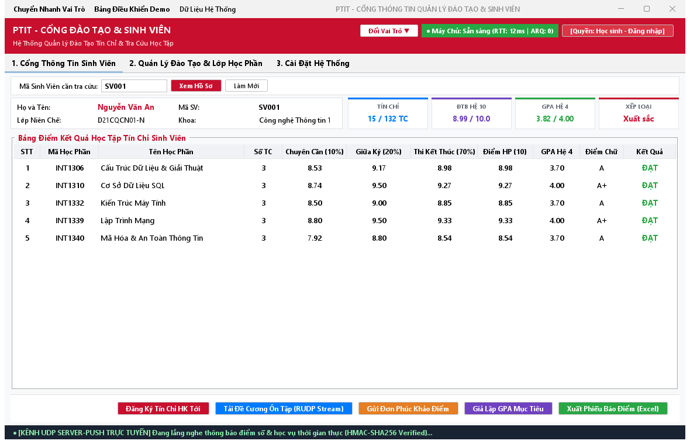 | 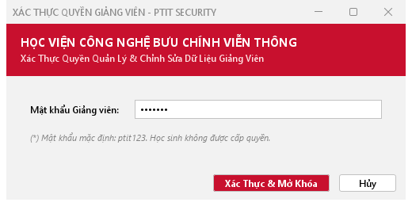 |
| *Sinh viên tra cứu bảng điểm 5 môn, tải đề cương RUDP Stream, gửi đơn phúc khảo & đăng ký tín chỉ* | *Xác thực tài khoản Giảng viên (`giangvien / ptit123`) hoặc Quản trị viên (`admin / admin123`)* |

| Phân Hệ Quản Lý Đào Tạo Giảng Viên (Toàn Quyền) | Phiếu Báo Điểm Chi Tiết Tín Chỉ & Chấm Điểm Môn |
| :---: | :---: |
| 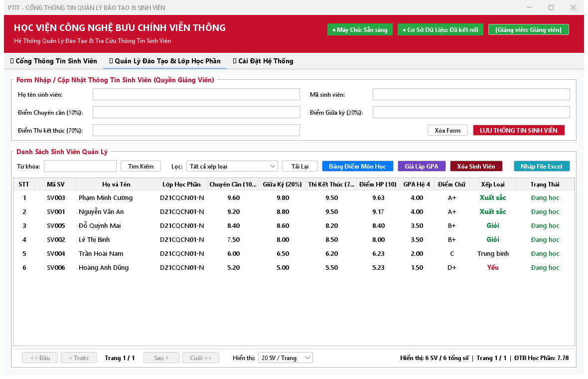 | 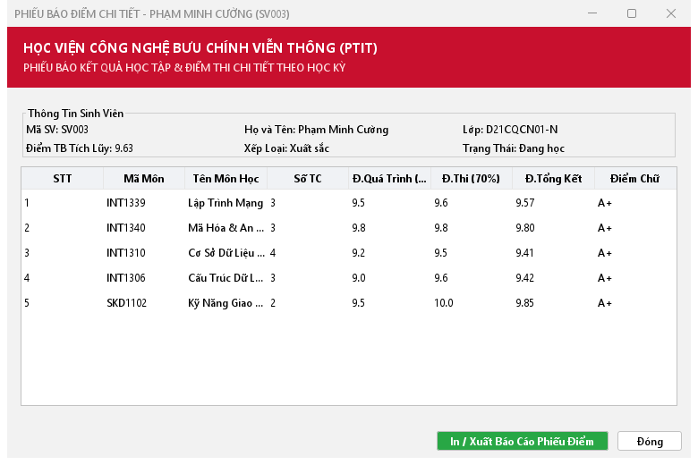 |
| *Quản lý danh sách 251 sinh viên, xét Học bổng KKHT, Cảnh báo học vụ, Duyệt phúc khảo & Nhập/Xuất Excel* | *Xem và chấm điểm trực tiếp từng môn học phần: Điểm quá trình (30%), Điểm thi (70%), GPA hệ 4 & Điểm chữ* |

| Bộ Giả Lập Điểm Mục Tiêu (GPA Simulator) | Hội Đồng Duyệt Phúc Khảo 2 Chiều & Đăng Ký Tín Chỉ HK Mới |
| :---: | :---: |
| 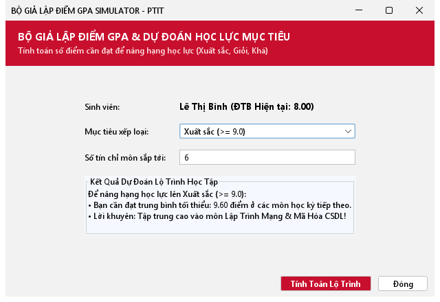 | 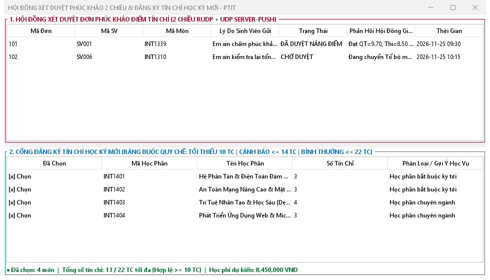 |
| *Tính toán số điểm cần đạt ở các tín chỉ kỳ tới để nâng hạng CPA* | *Xét duyệt đơn phúc khảo 2 chiều (tự động đẩy UDP Push) & Kiểm tra trần tín chỉ 14 TC / 22 TC* |

### 2️⃣ Phân Hệ Server — Kiểm Chứng Mã Hóa DES/AES-256, Phòng Thí Nghiệm RUDP & Biểu Đồ Kép

| Trung Tâm Kiểm Tra Mã Hóa CSDL & Khóa DES 8-Byte | Phòng Thí Nghiệm Mạng RUDP (Chaos, Benchmark & Audit) |
| :---: | :---: |
| 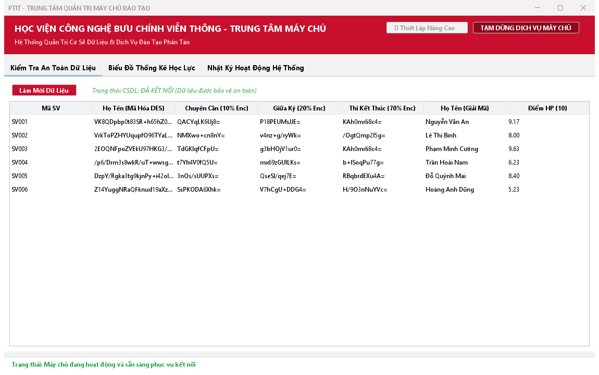 | 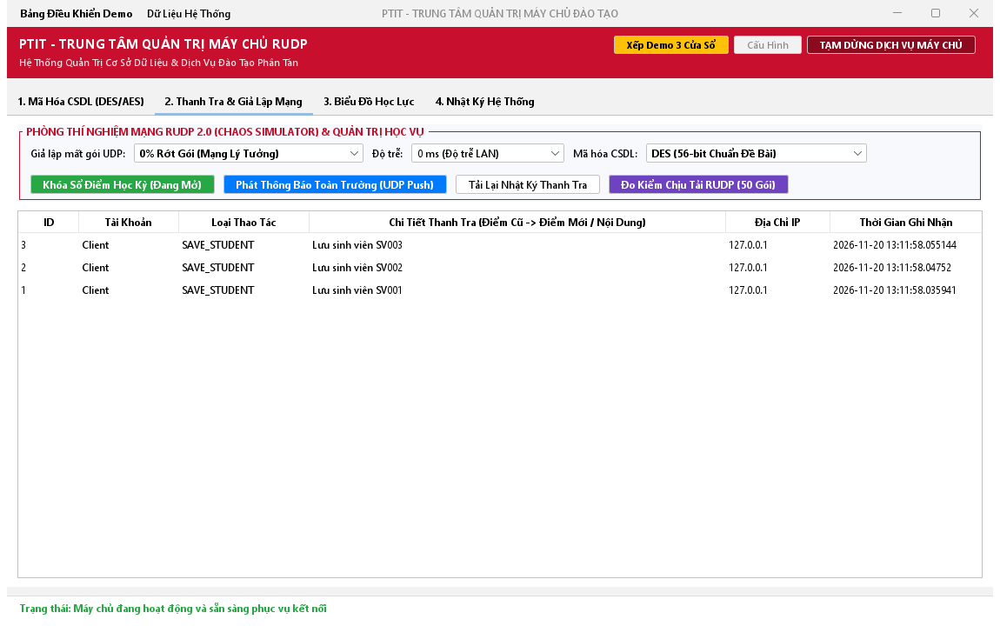 |
| *Đối chiếu bản mã Base64, xoay khóa trực tuyến `DES <-> AES-256`, Sao lưu/Khôi phục Snapshot HMAC & Thử khóa DES 8 ký tự* | *Giả lập rớt gói UDP (0–60%), đo kiểm chịu tải 50 gói đa luồng, Khóa sổ điểm học kỳ & Nhật ký thanh tra sửa điểm* |

| Biểu Đồ Kép JFreeChart (Tròn Xếp Loại + Cột Phổ Điểm) | Toàn Cảnh Hệ Thống Phân Tán Client – Server RUDP 2.0 |
| :---: | :---: |
| 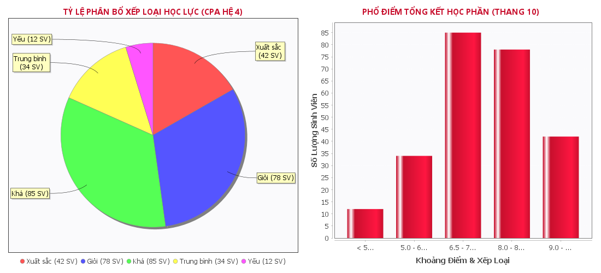 |  |
| *Trực quan hóa đồng thời Tỷ lệ xếp loại học lực (CPA hệ 4) và Phổ điểm học phần (Thang 10)* | *Mô hình truyền nhận gói tin RUDP 2.0 và đồng bộ kênh đẩy UDP Server-Push thời gian thực* |

---

## 🌟 1. Tính Năng Chi Tiết Phân Hệ

### 👨‍🎓 1.1. Phân Hệ Client (`ClientGUI.java`)

- **Giao diện chuẩn Enterprise PTIT**: Tone màu đỏ thương hiệu PTIT (`#C8102E`) kết hợp giao diện phẳng hiện đại **FlatLaf**.
- **Cơ Chế Bảo Vệ Phân Quyền Vai Trò (Role-Based Access Control)**:
  - **Chế độ Học sinh (Safe Mode - Mặc định khi bật app)**:
    - Form nhập/sửa điểm bị **ẩn hoàn toàn**, tránh việc học sinh can thiệp điểm số.
    - Nút Xóa sinh viên bị **vô hiệu hóa (Disabled)**.
    - Tab Cấu hình CSDL bị **ẩn**, ngăn học sinh thay đổi thông số kết nối.
    - Học sinh được phép tra cứu điểm, xem xếp loại, xem thống kê lớp.
  - **Quyền Giảng viên (Teacher Mode - Bảo vệ bằng mật khẩu)**:
    - Nhấp nút `🔒 Quyền: Học sinh` trên Header để mở cửa sổ xác thực.
    - Nhập mật khẩu Giảng viên (Mặc định: `ptit123` hoặc `admin123`).
    - Khi xác thực thành công: Badge chuyển sang xanh `🔓 Quyền: Giảng viên`, mở khóa toàn bộ Form nhập điểm, kích hoạt nút Xóa và hiển thị lại Tab Cấu hình CSDL.
- **Tra Cứu Phiếu Báo Điểm Chi Tiết Môn Học (Transcript Modal)**:
  - Chọn 1 dòng sinh viên hoặc double-click trên bảng ➔ Bấm nút **"Bảng Điểm Môn Học"**.
  - Hiển thị phiếu điểm chi tiết từng môn: Lập Trình Mạng, Mã Hóa & An Toàn Thông Tin, Cơ Sở Dữ Liệu SQL, Cấu Trúc Dữ Liệu & Giải Thuật, Kỹ Năng Giao Tiếp.
  - Hiển thị đầy đủ Số tín chỉ, Điểm Quá Trình (30%), Điểm Thi (70%), Điểm Tổng Kết hệ 10 và Điểm Chữ quy đổi (`A+`, `A`, `B+`...).
- **Bộ Giả Lập Điểm GPA Simulator (Target GPA Calculator)**:
  - Bấm nút **"Giả Lập GPA"** để mở công cụ dự đoán học lực.
  - Nhập mục tiêu xếp loại mong muốn (Xuất sắc, Giỏi, Khá) và số tín chỉ môn tiếp theo.
  - Hệ thống tự động tính toán số điểm tối thiểu cần đạt để vươn lên xếp loại mục tiêu.
- **Thanh Thống Kê Điểm Lớp Trực Quan (Dynamic Statistics Banner)**:
  - Tự động tính toán và hiển thị: `Tổng số SV`, `ĐTB Cao nhất`, `ĐTB Thấp nhất` và `ĐTB Trung bình lớp`.
- **Thao Tác Dữ Liệu Sinh Viên (CRUD Workspace - Dành cho Giảng viên)**:
  - Form nhập liệu sinh viên: Họ tên, Mã SV, Điểm Toán, Điểm Văn, Điểm Tiếng Anh.
  - Sửa nhanh Inline: Click dòng sinh viên trên JTable tự động điền thông tin lên Form để chỉnh sửa.
  - Xóa sinh viên: Chọn dòng trên bảng và nhấn `Xóa Dòng Chọn`.
- **Tìm Kiếm & Bộ Lọc Nâng Cao**: Tra cứu theo từ khóa (Mã SV / Họ tên) và lọc nhanh theo xếp loại học lực (`Xuất sắc`, `Giỏi`, `Khá`, `Trung bình`, `Yếu`).
- **Xuất Báo Cáo Excel (.xlsx)**: Đóng gói và xuất danh sách sinh viên ra tệp Excel định dạng chuẩn văn phòng bằng Apache POI.

### 🛡️ 1.2. Phân Hệ Server (`ServerGUI.java`) & Giao Thức Lõi RUDP 2.0

- **Giao Thức Mạng Tin Cậy RUDP 2.0 (`UDPPacket.java`)**:
  - Đánh số thứ tự `Sequence Number / ACK Number`, tự động phát lại gói tin khi mất gói (**Stop-and-Wait ARQ** với `Exponential Backoff`).
  - Bộ nhớ đệm **Idempotent LRU Response Cache** (500 `packetId` UUID) chống thực thi trùng lặp khi mạng rớt gói `ACK`.
  - Nén tự động **GZIP Compression** cho mọi gói tin `> 512 bytes` và truyền tệp đề cương học phần phân mảnh **RUDP Chunked File Streaming** kèm kiểm tra mã băm toàn vẹn **SHA-256 Checksum**.
  - Kênh thông báo đẩy hai chiều **Full-Duplex UDP Server-Push** (`PUSH_SUBSCRIBE` / `PUSH_EVENT`) đồng bộ điểm số và thông báo học vụ thời gian thực xuống mọi Client.
- **Động Cơ Bảo Mật Đa Lớp (`SecurityManager.java`)**:
  - Chuyển đổi trực tuyến và giải mã chéo giữa **DES (56-bit)** và **AES-256-GCM (PBKDF2WithHmacSHA256)**.
  - Chữ ký số toàn vẹn gói tin **HMAC-SHA256** và cửa sổ chống tấn công phát lại **Anti-Replay Attack ($\pm 5$ phút)**.
  - **Xoay Khóa & Tái Mã Hóa Toàn Bộ CSDL Trực Tuyến (`Live Key Rotation`)**: Chuyển đổi toàn bộ 251 bản ghi sinh viên trong CSDL giữa `DES <-> AES-256-GCM` trong một giao dịch ACID.
  - **Sao Lưu & Khôi Phục Snapshot CSDL Xác Thực Chữ Ký `HMAC-SHA256`**: Tự động phát hiện và từ chối khôi phục nếu tệp `.json` sao lưu bị kẻ gian chỉnh sửa trái phép.
- **Phòng Thí Nghiệm Mạng (`Network Chaos Simulator`) & Đo Kiểm Chịu Tải (`RUDP Stress Benchmark`)**:
  - Giả lập tỷ lệ rớt gói UDP (`0% - 60%`) và độ trễ mạng (`0ms - 300ms`) trực tiếp trên giao diện.
  - Công cụ **Đo kiểm chịu tải đa luồng (`50 gói RUDP song song / 5 luồng`)** đo thông lượng `Packets/sec`, `Avg/Max RTT (ms)` và số lần phát lại `ARQ`.
- **Hội Đồng Xét Duyệt Phúc Khảo Hai Chiều & Cổng Đăng Ký Tín Chỉ Học Kỳ Mới**:
  - Sinh viên gửi đơn phúc khảo từ Cổng Sinh viên; Giảng viên phê duyệt nâng điểm hoặc từ chối trực tiếp trên bảng Hội đồng Phúc khảo (tự động cập nhật CSDL và đẩy `UDP Server-Push`).
  - Cổng đăng ký tín chỉ học kỳ mới tự động kiểm tra quy chế: giới hạn tối đa **14 tín chỉ/kỳ** với sinh viên diện Cảnh báo học vụ (`GPA < 2.0`) và **22 tín chỉ/kỳ** với sinh viên bình thường.
- **Biểu Đồ Kép Thống Kê Học Lực (`JFreeChart Dual Charts`)**: Hiển thị song song **Biểu đồ Tròn tỷ lệ xếp loại học lực** và **Biểu đồ Cột phổ điểm tổng kết học phần thang 10**.

---

## 🏗️ 2. Kiến Trúc Hệ Thống & Luồng Dữ Liệu

### 📡 Sơ đồ Truyền Nhận Gói Tin UDP (Network Packet Flow)

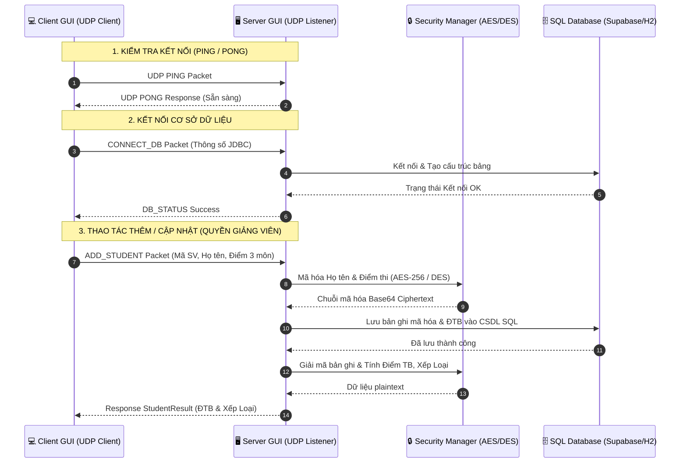

---

## 📁 3. Cấu Trúc Thư Mục Dự Án

```
LapTrinhMang-KetThucMon/
├── pom.xml                                  # Cấu hình Maven & Dependencies (FlatLaf, JFreeChart, POI, H2/PostgreSQL)
├── run.bat                                  # Script khởi chạy ứng dụng nhanh trên Windows
├── database.sql                             # Script SQL khởi tạo CSDL & 250+ bản ghi mẫu
├── README.md                                # Tài liệu hướng dẫn dự án & Bộ ảnh chụp màn hình
├── screenshots/                             # Thư mục chứa 8 ảnh chụp màn hình giao diện thực tế
│   ├── 01_client_student_mode.png          # Giao diện Client Chế độ Học sinh (Safe Mode)
│   ├── 02_teacher_auth_dialog.png          # Cửa sổ Xác thực Mật khẩu Giảng viên
│   ├── 03_client_teacher_mode.png          # Giao diện Client Chế độ Giảng viên (Toàn quyền)
│   ├── 04_student_transcript_modal.png     # Phiếu Báo Điểm Chi Tiết Môn Học
│   ├── 05_gpa_simulator_modal.png          # Bộ Giả Lập Điểm GPA Simulator
│   ├── 06_server_admin_dashboard.png       # Bảng Quản Trị Server & CSDL Mã Hóa
│   ├── 07_server_jfreechart_stats.png      # Biểu Đồ Thống Kê Học Lực JFreeChart
│   └── 08_ptit_full_system_overview.png    # Toàn Cảnh Hệ Thống Client - Server UDP
├── docs/                                    # Thư mục hồ sơ tài liệu chuyên sâu
│   ├── README.md                            # Mục lục & Ma trận tính năng hệ thống
│   ├── 01_CAU_TRUC_DU_AN.md                 # Cấu trúc dự án & Kiến trúc hệ thống
│   ├── 02_SO_DO_ERD.md                      # Sơ đồ thực thể ERD & CSDL SQL mở rộng
│   ├── 03_CHUC_NANG_HOC_SINH.md             # Chức năng phân hệ Học sinh (Chỉ xem)
│   ├── 04_CHUC_NANG_GIANG_VIEN_USER.md      # Chức năng phân hệ Giảng viên & Bảo vệ mật khẩu
│   └── 05_CHUC_NANG_ADMIN.md                # Chức năng phân hệ Quản trị viên Server
└── src/
    ├── main/java/com/qlsv/
    │   ├── AppLauncher.java                 # Trình khởi chạy hệ thống (Main Launcher)
    │   ├── model/                           # Model đối tượng: StudentData, StudentResult, SqlConfig
    │   ├── security/                        # Mã hóa AES-256 CBC, DES ECB, SecurityManager
    │   ├── database/                        # DatabaseManager quản lý JDBC & CRUD CSDL
    │   ├── network/                         # UDPPacket, PacketType, UDP Datagram Engine
    │   ├── util/                            # ExcelExporter xuất báo cáo .xlsx
    │   ├── server/                          # UDPServer (ThreadPool), ServerGUI (Admin)
    │   └── client/                          # UDPClient, ClientGUI (Student & Teacher Role)
    └── test/java/com/qlsv/
        ├── CaptureAllScreenshots.java       # Script tự động chụp toàn bộ 8 màn hình giao diện
        ├── GuiDemoAutomationRunner.java     # Demo kiểm thử giao diện tự động
        └── security/DESEncryptionTest.java  # Unit Test giải thuật mã hóa
```

---

## 🚀 4. Hướng Dẫn Khởi Chạy Ứng Dụng

### Cách 1: Khởi Chạy Bằng Lệnh npm (Khuyên Dùng)
Mở Terminal tại thư mục dự án và gõ lệnh:
```bash
npm run dev
```

### Cách 2: Sử Dụng Script Khởi Chạy Nhanh (`run.bat`)
Nhấp kép chuột vào tệp `run.bat` ở thư mục gốc dự án để bật ứng dụng.

### Cách 2: Khởi Chạy Bằng Lệnh Maven
```bash
# Khởi chạy Menu Launcher chung
mvn exec:java -Dexec.mainClass="com.qlsv.AppLauncher"

# Khởi chạy riêng Server GUI (Admin)
mvn exec:java -Dexec.mainClass="com.qlsv.server.ServerGUI"

# Khởi chạy riêng Client GUI
mvn exec:java -Dexec.mainClass="com.qlsv.client.ClientGUI"
```

### Cách 3: Chụp Lại Bộ Ảnh Màn Hình Giao Diện Mới
```bash
mvn exec:java -Dexec.mainClass="com.qlsv.CaptureAllScreenshots" -Dexec.classpathScope="test"
```

---

## 🏆 Thông Tin Học Phần & Nhóm Thực Hiện
- **Học viện**: Học viện Công nghệ Bưu chính Viễn thông (PTIT)
- **Môn học**: Lập Trình Mạng — Đồ án Kết thúc học phần
- **Nhóm thực hiện**: **Nhóm 2** (`D24TXCN01-N` / `D24TXCNPM01-N`)
- **Nhóm trưởng (Team Leader & Core Architect)**: **Phạm Công Thành (`N24DTCN079`)** — `n24dtcn079@student.ptithcm.edu.vn`
- **Các thành viên**:
  - **Hồ Quốc Khải (`N24DTCN042`)** — `n24dtcn042@student.ptithcm.edu.vn`
  - **Dương Trung Dũng (`N24DTCN017`)** — `n24dtcn017@student.ptithcm.edu.vn`
  - **Cao Thành Long (`N24DTCN050`)** — `n24dtcn050@student.ptithcm.edu.vn`
  - **Nguyễn Duy Quang Nhật (`N24DTCN119`)** — `n24dtcn119@student.ptithcm.edu.vn`
  - **Nguyễn Quang Hoàng (`N24DTCN032`)** — `n24dtcn032@student.ptithcm.edu.vn`
