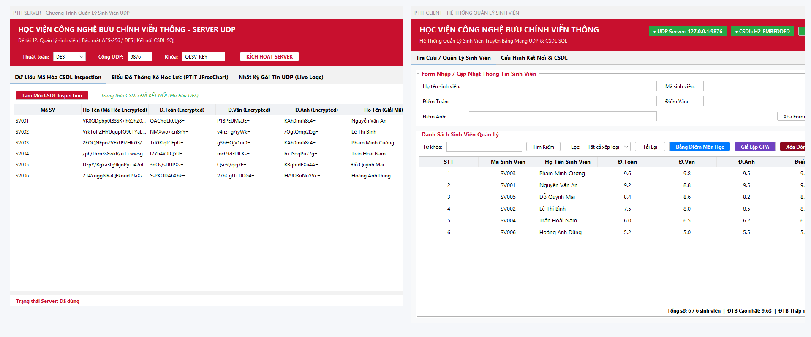
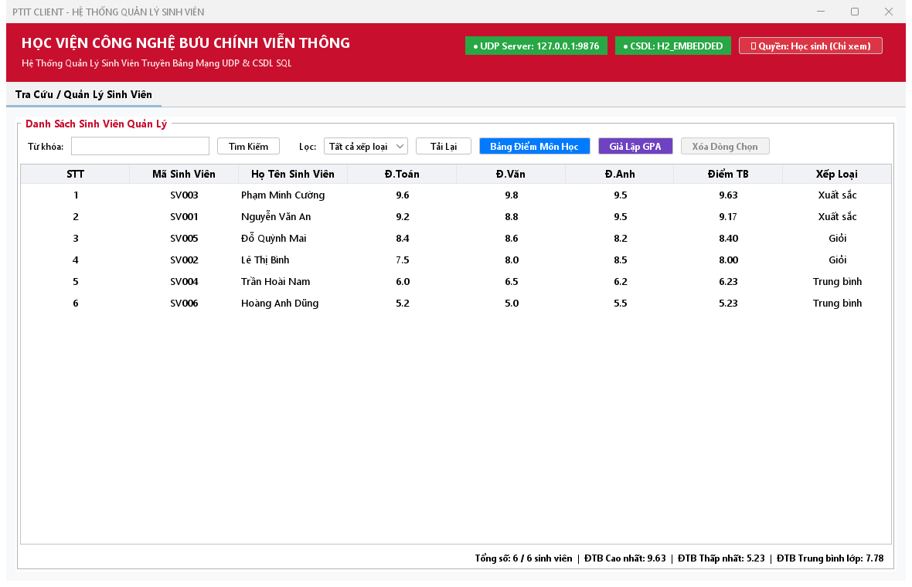
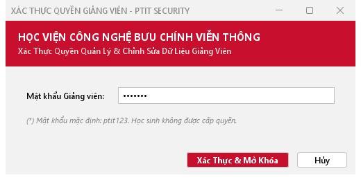
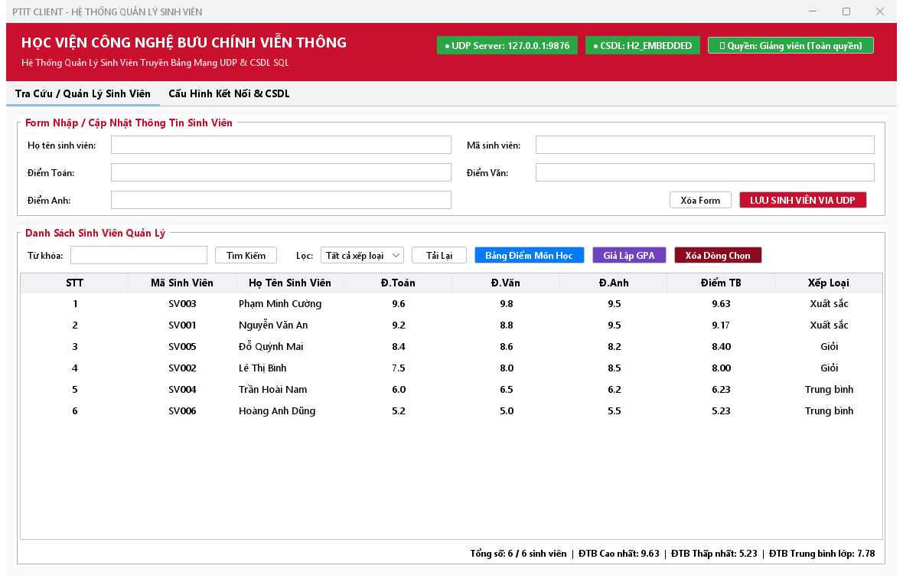
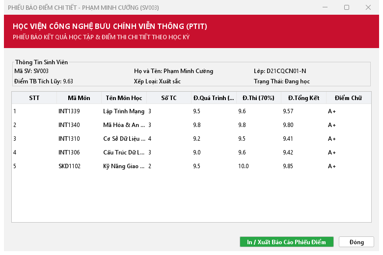
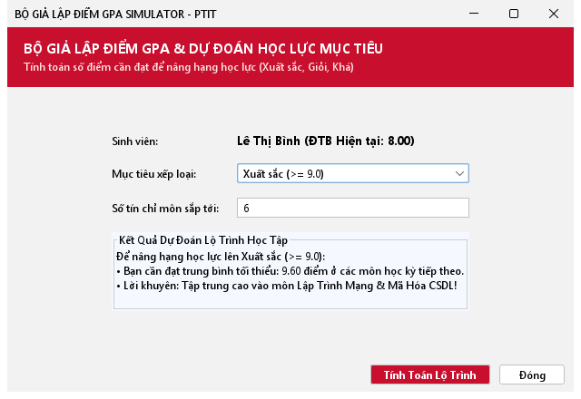
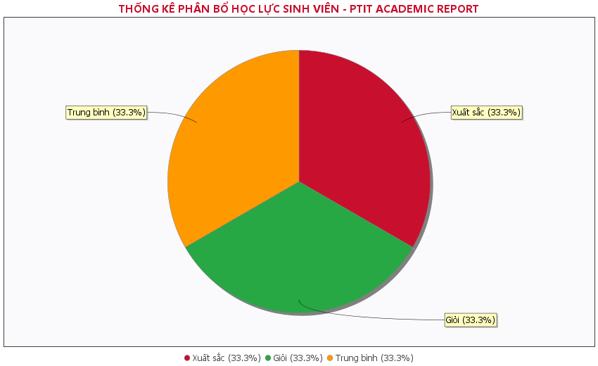
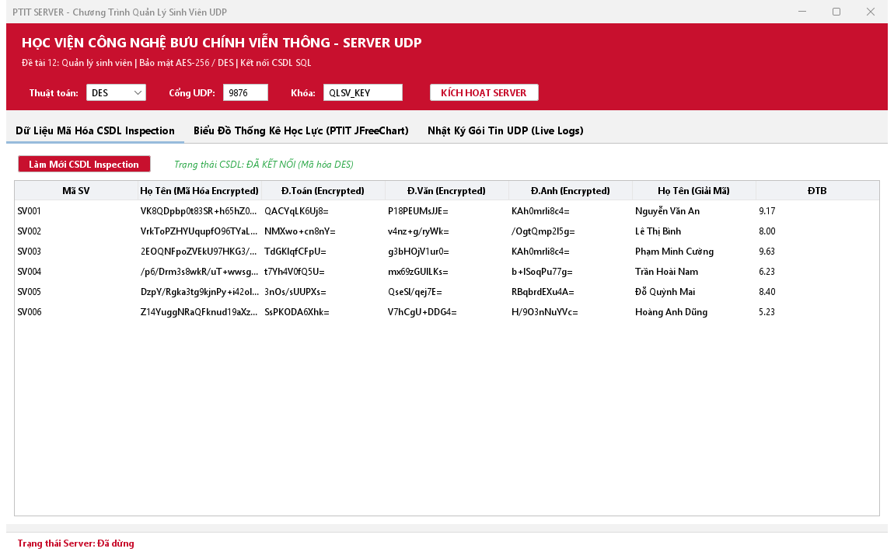
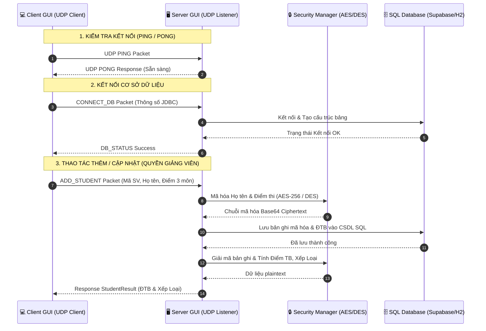

# 🎓 HỌC VIỆN CÔNG NGHỆ BƯU CHÍNH VIỄN THÔNG (PTIT)
## Đề Tài 12: Hệ Thống Quản Lý Sinh Viên Truyền Bảng Mạng UDP & Bảo Mật Mã Hóa CSDL SQL



Hệ thống ứng dụng quản lý sinh viên phân tán Client-Server viết bằng ngôn ngữ Java, truyền nhận gói tin thời gian thực qua giao thức **UDP (`DatagramSocket`)**, tích hợp cơ chế bảo mật mã hóa đối xứng **AES-256 / DES**, lưu trữ cơ sở dữ liệu đa nền tảng **SQL (Supabase Cloud PostgreSQL / H2 Embedded / SQL Server / MySQL)**, cơ chế **Bảo vệ Phân quyền Giảng viên & Học sinh (Role-Based Access Control)** và xuất báo cáo chuẩn **Excel (.xlsx)**.

---

## 📸 BỘ ẢNH CHỤP MÀN HÌNH GIAO DIỆN HỆ THỐNG (SCREENSHOTS GALLERY)

Toàn bộ ảnh chụp thực tế của hệ thống được lưu trữ trong thư mục [`screenshots/`](./screenshots):

### 1️⃣ Phân Hệ Client - Chế Độ Học Sinh & Giảng Viên

| Chế độ Học sinh (Safe Mode - Chỉ xem) | Xác thực Mật khẩu Giảng viên |
| :---: | :---: |
|  |  |
| *Học sinh chỉ tra cứu điểm, Form nhập bị ẩn, nút xóa bị khóa* | *Nhập mật khẩu (`ptit123`) để mở khóa quyền Giảng viên* |

| Chế độ Giảng viên (Toàn quyền quản lý) | Báo Cáo Phiếu Điểm Chi Tiết Môn Học |
| :---: | :---: |
|  |  |
| *Mở khóa Form nhập điểm, nút Xóa kích hoạt, Tab Cấu hình CSDL* | *Xem điểm chi tiết 5 môn, điểm quá trình 30%, điểm thi 70%, điểm chữ A+* |

| Bộ Giả Lập Điểm GPA Simulator | Biểu Đồ Thống Kê Học Lực JFreeChart |
| :---: | :---: |
|  |  |
| *Tính toán số điểm cần đạt ở môn tiếp theo để nâng hạng học lực* | *Trực quan hóa tỷ lệ phân bổ xếp loại học lực toàn trường* |

### 2️⃣ Phân Hệ Server - Quản Trị Viên & An Toàn Thông Tin

| Bảng Quản Trị Server & CSDL Mã Hóa Base64 | Toàn Cảnh Kết Nối Client - Server UDP |
| :---: | :---: |
|  |  |
| *Đối chiếu Ciphertext mã hóa trong SQL và dữ liệu giải mã* | *Mô hình truyền nhận gói tin thời gian thực qua cổng UDP 9876* |

---

## 🌟 1. Tính Năng Chi Tiết Phân Hệ

### 👨‍🎓 1.1. Phân Hệ Client (`ClientGUI.java`)

- **Giao diện chuẩn Enterprise PTIT**: Tone màu đỏ thương hiệu PTIT (`#C8102E`) kết hợp giao diện phẳng hiện đại **FlatLaf**.
- **Cơ Chế Bảo Vệ Phân Quyền Vai Trò (Role-Based Access Control)**:
  - **Chế độ Học sinh (Safe Mode - Mặc định khi bật app)**:
    - Form nhập/sửa điểm bị **ẩn hoàn toàn**, tránh việc học sinh can thiệp điểm số.
    - Nút Xóa sinh viên bị **vô hiệu hóa (Disabled)**.
    - Tab Cấu hình CSDL bị **ẩn**, ngăn học sinh thay đổi thông số kết nối.
    - Học sinh được phép tra cứu điểm, xem xếp loại, xem thống kê lớp.
  - **Quyền Giảng viên (Teacher Mode - Bảo vệ bằng mật khẩu)**:
    - Nhấp nút `🔒 Quyền: Học sinh` trên Header để mở cửa sổ xác thực.
    - Nhập mật khẩu Giảng viên (Mặc định: `ptit123` hoặc `admin123`).
    - Khi xác thực thành công: Badge chuyển sang xanh `🔓 Quyền: Giảng viên`, mở khóa toàn bộ Form nhập điểm, kích hoạt nút Xóa và hiển thị lại Tab Cấu hình CSDL.
- **Tra Cứu Phiếu Báo Điểm Chi Tiết Môn Học (Transcript Modal)**:
  - Chọn 1 dòng sinh viên hoặc double-click trên bảng ➔ Bấm nút **"Bảng Điểm Môn Học"**.
  - Hiển thị phiếu điểm chi tiết từng môn: Lập Trình Mạng, Mã Hóa & An Toàn Thông Tin, Cơ Sở Dữ Liệu SQL, Cấu Trúc Dữ Liệu & Giải Thuật, Kỹ Năng Giao Tiếp.
  - Hiển thị đầy đủ Số tín chỉ, Điểm Quá Trình (30%), Điểm Thi (70%), Điểm Tổng Kết hệ 10 và Điểm Chữ quy đổi (`A+`, `A`, `B+`...).
- **Bộ Giả Lập Điểm GPA Simulator (Target GPA Calculator)**:
  - Bấm nút **"Giả Lập GPA"** để mở công cụ dự đoán học lực.
  - Nhập mục tiêu xếp loại mong muốn (Xuất sắc, Giỏi, Khá) và số tín chỉ môn tiếp theo.
  - Hệ thống tự động tính toán số điểm tối thiểu cần đạt để vươn lên xếp loại mục tiêu.
- **Thanh Thống Kê Điểm Lớp Trực Quan (Dynamic Statistics Banner)**:
  - Tự động tính toán và hiển thị: `Tổng số SV`, `ĐTB Cao nhất`, `ĐTB Thấp nhất` và `ĐTB Trung bình lớp`.
- **Thao Tác Dữ Liệu Sinh Viên (CRUD Workspace - Dành cho Giảng viên)**:
  - Form nhập liệu sinh viên: Họ tên, Mã SV, Điểm Toán, Điểm Văn, Điểm Tiếng Anh.
  - Sửa nhanh Inline: Click dòng sinh viên trên JTable tự động điền thông tin lên Form để chỉnh sửa.
  - Xóa sinh viên: Chọn dòng trên bảng và nhấn `Xóa Dòng Chọn`.
- **Tìm Kiếm & Bộ Lọc Nâng Cao**: Tra cứu theo từ khóa (Mã SV / Họ tên) và lọc nhanh theo xếp loại học lực (`Xuất sắc`, `Giỏi`, `Khá`, `Trung bình`, `Yếu`).
- **Xuất Báo Cáo Excel (.xlsx)**: Đóng gói và xuất danh sách sinh viên ra tệp Excel định dạng chuẩn văn phòng bằng Apache POI.

### 🛡️ 1.2. Phân Hệ Server (`ServerGUI.java`)

- **Bảng Console Quản trị Server**: Bật / Dừng lắng nghe cổng UDP (Default `9876`), xử lý đa luồng ThreadPool.
- **Lựa Chọn Thuật Toán Mã Hóa Bảo Mật**: Chuyển đổi linh hoạt giữa **AES-256 (CBC)** và **DES (ECB)** thời gian thực.
- **Giám Sát Mã Hóa CSDL (Encrypted Data Inspection)**: Hiển thị bảng đối chiếu trực quan giữa chuỗi thô mã hóa Base64 lưu trong SQL và dữ liệu sau khi giải mã.
- **Biểu Đồ Thống Kê Học Lực (PTIT JFreeChart)**: Trực quan hóa tỷ lệ phần trăm phân bổ xếp loại học lực toàn trường.
- **Nhật Ký Live UDP Traffic (Real-time Logs)**: Theo dõi từng gói tin UDP gửi/nhận theo thời gian thực (`PING`, `CONNECT_DB`, `ADD_STUDENT`, `SEARCH`, `DELETE`...).

---

## 🏗️ 2. Kiến Trúc Hệ Thống & Luồng Dữ Liệu

### 📡 Sơ đồ Truyền Nhận Gói Tin UDP (Network Packet Flow)



---

## 📁 3. Cấu Trúc Thư Mục Dự Án

```
LapTrinhMang-KetThucMon/
├── pom.xml                                  # Cấu hình Maven & Dependencies (FlatLaf, JFreeChart, POI, H2/PostgreSQL)
├── run.bat                                  # Script khởi chạy ứng dụng nhanh trên Windows
├── database.sql                             # Script SQL khởi tạo CSDL & 250+ bản ghi mẫu
├── README.md                                # Tài liệu hướng dẫn dự án & Bộ ảnh chụp màn hình
├── screenshots/                             # Thư mục chứa 8 ảnh chụp màn hình giao diện thực tế
│   ├── 01_client_student_mode.png          # Giao diện Client Chế độ Học sinh (Safe Mode)
│   ├── 02_teacher_auth_dialog.png          # Cửa sổ Xác thực Mật khẩu Giảng viên
│   ├── 03_client_teacher_mode.png          # Giao diện Client Chế độ Giảng viên (Toàn quyền)
│   ├── 04_student_transcript_modal.png     # Phiếu Báo Điểm Chi Tiết Môn Học
│   ├── 05_gpa_simulator_modal.png          # Bộ Giả Lập Điểm GPA Simulator
│   ├── 06_server_admin_dashboard.png       # Bảng Quản Trị Server & CSDL Mã Hóa
│   ├── 07_server_jfreechart_stats.png      # Biểu Đồ Thống Kê Học Lực JFreeChart
│   └── 08_ptit_full_system_overview.png    # Toàn Cảnh Hệ Thống Client - Server UDP
├── docs/                                    # Thư mục hồ sơ tài liệu chuyên sâu
│   ├── README.md                            # Mục lục & Ma trận tính năng hệ thống
│   ├── 01_CAU_TRUC_DU_AN.md                 # Cấu trúc dự án & Kiến trúc hệ thống
│   ├── 02_SO_DO_ERD.md                      # Sơ đồ thực thể ERD & CSDL SQL mở rộng
│   ├── 03_CHUC_NANG_HOC_SINH.md             # Chức năng phân hệ Học sinh (Chỉ xem)
│   ├── 04_CHUC_NANG_GIANG_VIEN_USER.md      # Chức năng phân hệ Giảng viên & Bảo vệ mật khẩu
│   └── 05_CHUC_NANG_ADMIN.md                # Chức năng phân hệ Quản trị viên Server
└── src/
    ├── main/java/com/qlsv/
    │   ├── AppLauncher.java                 # Trình khởi chạy hệ thống (Main Launcher)
    │   ├── model/                           # Model đối tượng: StudentData, StudentResult, SqlConfig
    │   ├── security/                        # Mã hóa AES-256 CBC, DES ECB, SecurityManager
    │   ├── database/                        # DatabaseManager quản lý JDBC & CRUD CSDL
    │   ├── network/                         # UDPPacket, PacketType, UDP Datagram Engine
    │   ├── util/                            # ExcelExporter xuất báo cáo .xlsx
    │   ├── server/                          # UDPServer (ThreadPool), ServerGUI (Admin)
    │   └── client/                          # UDPClient, ClientGUI (Student & Teacher Role)
    └── test/java/com/qlsv/
        ├── CaptureAllScreenshots.java       # Script tự động chụp toàn bộ 8 màn hình giao diện
        ├── GuiDemoAutomationRunner.java     # Demo kiểm thử giao diện tự động
        └── security/DESEncryptionTest.java  # Unit Test giải thuật mã hóa
```

---

## 🚀 4. Hướng Dẫn Khởi Chạy Ứng Dụng

### Cách 1: Sử Dụng Script Khởi Chạy Nhanh (`run.bat`)
Nhấp kép chuột vào tệp `run.bat` ở thư mục gốc dự án để bật ứng dụng.

### Cách 2: Khởi Chạy Bằng Lệnh Maven
```bash
# Khởi chạy Menu Launcher chung
mvn exec:java -Dexec.mainClass="com.qlsv.AppLauncher"

# Khởi chạy riêng Server GUI (Admin)
mvn exec:java -Dexec.mainClass="com.qlsv.server.ServerGUI"

# Khởi chạy riêng Client GUI
mvn exec:java -Dexec.mainClass="com.qlsv.client.ClientGUI"
```

### Cách 3: Chụp Lại Bộ Ảnh Màn Hình Giao Diện Mới
```bash
mvn exec:java -Dexec.mainClass="com.qlsv.CaptureAllScreenshots" -Dexec.classpathScope="test"
```

---

## 🏆 Đóng Góp Dự Án
- **Tác giả / Lead Developer**: Phạm Công Thành (phamcongthanhvn2k6)
- **Học viện**: Học viện Công nghệ Bưu chính Viễn thông (PTIT)
- **Môn học**: Lập Trình Mạng - Đề tài 12 Kết thúc môn
