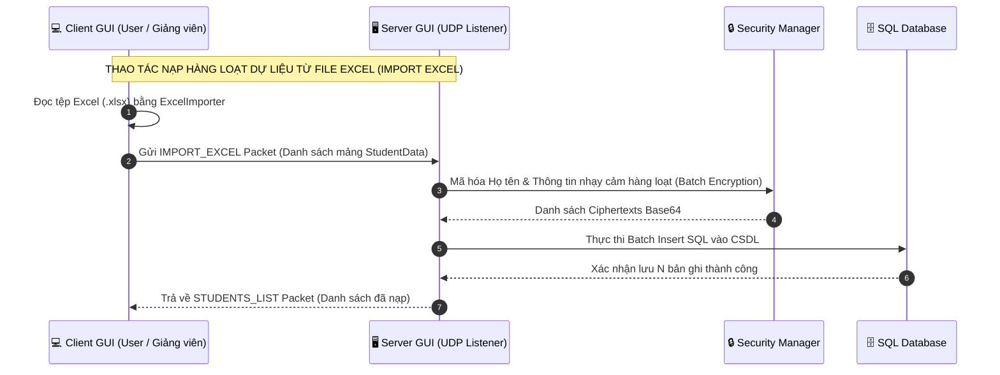

# 🏗️ CẤU TRÚC DỰ ÁN & KIẾN TRÚC HỆ THỐNG (BỔ SUNG TÍNH NĂNG MỚI)
## 🎓 HỌC VIỆN CÔNG NGHỆ BƯU CHÍNH VIỄN THÔNG (PTIT)
**Dự án**: Hệ Thống Quản Lý Sinh Viên Truyền Bảng Mạng UDP & Bảo Mật Mã Hóa CSDL SQL

---

## 1. 📁 CẤU TRÚC THƯ MỤC MÃ NGUỒN VÀ CÁC THÀNH PHẦN MỚI BỔ SUNG

Dự án được cấu trúc chuẩn theo mô hình Java Maven Enterprise, phân tách rõ ràng giữa các phân hệ Giao diện, Mạng UDP, Mã hóa bảo mật, Cơ sở dữ liệu và Model:

```
LapTrinhMang-KetThucMon/
├── pom.xml                                  # Cấu hình Maven & dependencies (FlatLaf, JFreeChart, Supabase/H2 JDBC, POI Excel)
├── run.bat                                  # Script hỗ trợ khởi chạy ứng dụng nhanh trên Windows
├── database.sql                             # Script SQL khởi tạo CSDL PostgreSQL / H2 & 250+ bản ghi mẫu
├── README.md                                # Hướng dẫn dự án tổng quan
├── docs/                                    # Thư mục lưu trữ tài liệu hệ thống
│   ├── README.md                            # Mục lục & Ma trận tính năng hệ thống
│   ├── 01_CAU_TRUC_DU_AN.md                 # Cấu trúc dự án & Kiến trúc hệ thống
│   ├── 02_SO_DO_ERD.md                      # Sơ đồ thực thể ERD & CSDL SQL mở rộng
│   ├── 03_CHUC_NANG_HOC_SINH.md             # Chức năng phân hệ Học sinh / Sinh viên mở rộng
│   ├── 04_CHUC_NANG_GIANG_VIEN_USER.md      # Chức năng phân hệ Giảng viên / User mở rộng
│   └── 05_CHUC_NANG_ADMIN.md                # Chức năng phân hệ Admin / Server GUI mở rộng
└── src/
    ├── main/
    │   └── java/
    │       └── com/
    │           └── qlsv/
    │               ├── AppLauncher.java     # Trình khởi chạy hệ thống (Main Menu Launcher)
    │               ├── model/               # Các đối tượng mô tả dữ liệu (Entities/DTOs)
    │               │   ├── StudentData.java # Model thông tin sinh viên đầu vào
    │               │   ├── StudentResult.java# Model kết quả học tập (ĐTB, Xếp loại)
    │               │   ├── SqlConfig.java   # Model thông số kết nối CSDL SQL
    │               │   ├── UserAccount.java # [MỚI] Model tài khoản & phân quyền (RBAC)
    │               │   └── AuditLog.java    # [MỚI] Model nhật ký kiểm toán hệ thống
    │               ├── security/            # Phân hệ Mã hóa & An toàn thông tin
    │               │   ├── SecurityManager.java # Trình quản lý chọn thuật toán AES/DES
    │               │   ├── AESEncryption.java   # Thuật toán mã hóa đối xứng AES-256 CBC
    │               │   └── DESEncryption.java   # Thuật toán mã hóa đối xứng DES ECB
    │               ├── database/            # Phân hệ Tương tác Cơ sở dữ liệu
    │               │   └── DatabaseManager.java # Quản lý kết nối JDBC, CRUD, Backup & View CSDL
    │               ├── network/             # Phân hệ Mạng truyền thông UDP
    │               │   ├── UDPPacket.java   # Cấu trúc gói tin dữ liệu chuẩn tuần tự hóa (Serializable)
    │               │   └── PacketType.java  # Định nghĩa các loại thao tác gói tin UDP (Đã bổ sung)
    │               ├── util/                # Tiện ích mở rộng
    │               │   ├── ExcelExporter.java # Xuất danh sách sinh viên ra tệp Excel (.xlsx)
    │               │   └── ExcelImporter.java # [MỚI] Đọc & Nhập danh sách sinh viên từ file Excel
    │               ├── server/              # Phân hệ Quản trị Server UDP & Admin
    │               │   ├── UDPServer.java   # UDP Listener Server đa luồng (ThreadPool Executed)
    │               │   └── ServerGUI.java   # Giao diện Admin giám sát, phân quyền & điều khiển Server
    │               └── client/              # Phân hệ Giao diện User / Giảng viên / Sinh viên
    │                   ├── UDPClient.java   # UDP Network Engine phía Client (Timeout handling)
    │                   └── ClientGUI.java   # Giao diện người dùng Quản lý Sinh viên (Swing + FlatLaf)
    └── test/
        └── java/
            └── com/
                └── qlsv/
                    ├── security/
                    │   └── DESEncryptionTest.java # Unit Test giải thuật mã hóa DES
                    ├── network/
                    │   ├── FullSystemIntegrationTest.java # Kiểm thử tích hợp toàn hệ thống
                    │   └── SupabaseTest.java              # Kiểm thử kết nối Cloud CSDL Supabase
                    └── GuiDemoAutomationRunner.java       # Script tự động hóa kiểm thử giao diện
```

---

## 2. 📡 BẢNG MỞ RỘNG CÁC GÓI TIN UDP (`PacketType`)

Giao thức UDP được mở rộng bổ sung các gói tin mới để phục vụ tính năng nâng cao:

| PacketType | Hướng truyền | Chức năng chi tiết | Phân loại |
| :--- | :--- | :--- | :--- |
| `PING` | Client ➔ Server | Kiểm tra trạng thái sống/chết (Heartbeat) của UDP Server. | Cơ bản |
| `PONG` | Server ➔ Client | Phản hồi xác nhận Server đang hoạt động tốt. | Cơ bản |
| `CONNECT_DB` | Client ➔ Server | Gửi thông số cấu hình kết nối CSDL SQL. | Cơ bản |
| `DB_STATUS` | Server ➔ Client | Trả về kết quả khởi tạo và kết nối cơ sở dữ liệu. | Cơ bản |
| `ADD_STUDENT` | Client ➔ Server | Gửi dữ liệu sinh viên mới cần thêm vào hệ thống. | Cơ bản |
| `UPDATE_STUDENT` | Client ➔ Server | Gửi yêu cầu cập nhật thông tin sinh viên đã tồn tại. | Cơ bản |
| `DELETE_STUDENT` | Client ➔ Server | Gửi yêu cầu xóa bản ghi sinh viên theo Mã SV. | Cơ bản |
| `SEARCH_STUDENTS` | Client ➔ Server | Gửi từ khóa tìm kiếm (Mã SV / Họ tên) tới Server. | Cơ bản |
| `GET_ALL_STUDENTS` | Client ➔ Server | Yêu cầu Server tải toàn bộ danh sách sinh viên hiện có. | Cơ bản |
| `STUDENT_RESULT` | Server ➔ Client | Trả về kết quả tính toán ĐTB và Xếp loại học lực. | Cơ bản |
| `STUDENTS_LIST` | Server ➔ Client | Trả về mảng danh sách sinh viên đã giải mã. | Cơ bản |
| `ERROR` | Server ➔ Client | Trả về thông báo lỗi chi tiết khi thao tác thất bại. | Cơ bản |
| `LOGIN` **[MỚI]** | Client ➔ Server | Gửi thông tin đăng nhập (Username/Password) xác thực tài khoản. | **Bổ sung / Nâng cao** |
| `IMPORT_EXCEL` **[MỚI]** | Client ➔ Server | Gửi danh sách sinh viên đọc từ file Excel để lưu hàng loạt (Bulk Insert). | **Bổ sung / Nâng cao** |
| `GET_TRANSCRIPT` **[MỚI]**| Client ➔ Server | Lấy bảng điểm môn học chi tiết của 1 sinh viên cụ thể. | **Bổ sung / Nâng cao** |
| `BACKUP_DB` **[MỚI]** | Client ➔ Server | Yêu cầu Server tạo bản sao lưu dữ liệu CSDL SQL (`.sql`). | **Bổ sung / Nâng cao** |
| `ROTATE_KEY` **[MỚI]** | Client ➔ Server | Yêu cầu xoay khóa mã hóa Secret Key (Re-encrypt data). | **Bổ sung / Nâng cao** |

---

## 3. 🔄 LUỒNG XỬ LÝ TRUYỀN NHẬN GÓI TIN MỞ RỘNG


