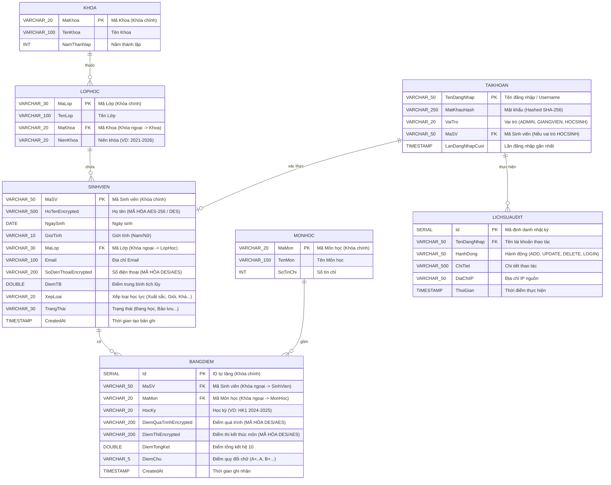

# 🗄️ SƠ ĐỒ ERD & MÔ HÌNH CƠ SỞ DỮ LIỆU SQL (BỔ SUNG MỞ RỘNG)
## 🎓 HỌC VIỆN CÔNG NGHỆ BƯU CHÍNH VIỄN THÔNG (PTIT)
**Dự án**: Hệ Thống Quản Lý Sinh Viên Truyền Bảng Mạng UDP & Bảo Mật Mã Hóa CSDL SQL

---

## 1. 📊 SƠ ĐỒ THỰC THỂ MỐI QUAN HỆ ERD MỞ RỘNG (EXTENDED ERD)

Sơ đồ thể hiện toàn bộ các thực thể cốt lõi và **bổ sung thêm thực thể TaiKhoan (Xác thực & Phân quyền) và LichSuAudit (Nhật ký hệ thống)**:

---

## 2. 📋 CHI TIẾT CÁC BẢNG CSDL SQL BỔ SUNG

### 2.1. Bảng `TaiKhoan` (Xác thực & Phân quyền Nguời dùng - RBAC) [MỚI]
Bảng lưu trữ thông tin đăng nhập và phân định quyền hạn sử dụng ứng dụng.

| Tên trường | Kiểu dữ liệu | Ràng buộc | Mô tả |
| :--- | :--- | :--- | :--- |
| `TenDangNhap` | `VARCHAR(50)` | `PRIMARY KEY` | Tên đăng nhập duy nhất (VD: `admin`, `giangvien01`, `SV001`). |
| `MatKhauHash` | `VARCHAR(250)`| `NOT NULL` | Mật khẩu đã băm an toàn bằng thuật toán SHA-256 + Salt. |
| `VaiTro` | `VARCHAR(20)` | `NOT NULL` | Phân quyền vai trò (`ADMIN`, `GIANGVIEN`, `HOCSINH`). |
| `MaSV` | `VARCHAR(50)` | `FOREIGN KEY` | Liên kết tới `SinhVien(MaSV)` nếu tài khoản thuộc vai trò HOCSINH. |
| `LanDangNhapCuoi`|`TIMESTAMP` | `NULLABLE` | Thời gian lần truy cập gần nhất. |

---

### 2.2. Bảng `LichSuAudit` (Nhật ký Kiểm toán & An toàn Thông tin) [MỚI]
Bảng ghi nhận toàn bộ nhật ký thao tác dữ liệu nhạy cảm của người dùng.

| Tên trường | Kiểu dữ liệu | Ràng buộc | Mô tả |
| :--- | :--- | :--- | :--- |
| `Id` | `SERIAL` | `PRIMARY KEY` | Mã định danh tự tăng. |
| `TenDangNhap` | `VARCHAR(50)` | `FOREIGN KEY` | Tài khoản thực hiện hành động. |
| `HanhDong` | `VARCHAR(50)` | `NOT NULL` | Loại thao tác (`LOGIN`, `ADD_STUDENT`, `UPDATE_STUDENT`, `DELETE_STUDENT`, `IMPORT_EXCEL`). |
| `ChiTiet` | `VARCHAR(500)`| `NULLABLE` | Thông tin chi tiết bản ghi bị tác động. |
| `DiaChiIP` | `VARCHAR(50)` | `NULLABLE` | Địa chỉ IP của Client gửi yêu cầu. |
| `ThoiGian` | `TIMESTAMP` | `DEFAULT CURRENT_TIMESTAMP` | Thời điểm ghi nhận log. |

---

## 3. 🛡️ QUY TRÌNH MÃ HÓA DỮ LIỆU & BẢO MẬT MẬT KHẨU

1. **Mã hóa Dữ liệu Học sinh & Điểm thi**:
   - Sử dụng **AES-256 CBC** hoặc **DES ECB** chuyển đổi sang **Base64 String**.
2. **Băm Mật khẩu Tài khoản (Password Hashing)**:
   - Mật khẩu đăng nhập của Admin/Giảng viên/Học sinh không lưu dưới dạng plaintext mà được băm 1 chiều SHA-256 trước khi lưu vào bảng `TaiKhoan`.
