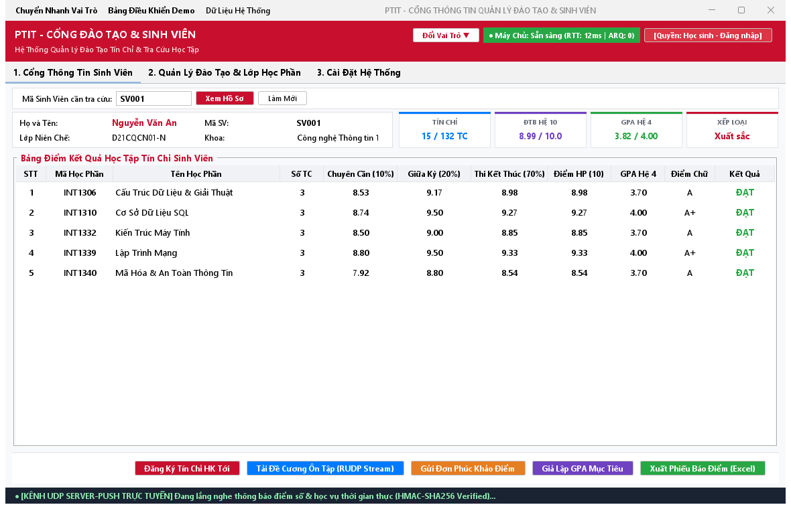

# PHÂN HỆ CỔNG THÔNG TIN SINH VIÊN (STUDENT PORTAL)
## HỌC VIỆN CÔNG NGHỆ BƯU CHÍNH VIỄN THÔNG (PTIT)
**Dự án**: Hệ Thống Quản Lý Đào Tạo Tín Chỉ & Sinh Viên Qua Mạng RUDP 2.0

---

## 1. GIAO DIỆN CỔNG THÔNG TIN SINH VIÊN ĐỘC LẬP

Khi sinh viên truy cập hệ thống (hoặc chọn **Cổng Thông Tin Sinh Viên** từ `AppLauncher`), hệ thống cung cấp không gian tra cứu học tập cá nhân hóa theo chuẩn đào tạo tín chỉ đại học, đồng thời **khóa và ẩn toàn bộ công cụ chỉnh sửa điểm của Giảng viên**:

### Các Thành Phần Chính Trên Cổng Sinh Viên:
1. **Hồ Sơ Sinh Viên & Tìm Kiếm Nhanh:**
   - Tra cứu theo Mã Sinh Viên (`SV001` - `SV250`).
   - Hiển thị Họ và Tên (đã giải mã), Mã SV, Lớp niên chế (`D21CQCN01-N`), Khoa quản lý (`CNTT 1`).
2. **4 Thẻ Chỉ Số Học Tập Tín Chỉ (Academic KPI Cards):**
   - **TÍN CHỈ:** Số tín chỉ tích lũy đạt trên tổng số tín chỉ toàn khóa (`15 / 132 TC`).
   - **ĐTB HỆ 10:** Điểm trung bình học kỳ thang điểm 10.
   - **GPA HỆ 4:** Điểm trung bình tích lũy quy đổi thang điểm 4.0 chuẩn tín chỉ.
   - **XẾP LOẠI:** Xếp loại học lực (`Xuất sắc`, `Giỏi`, `Khá`, `Trung bình`, `Yếu/Kém`).
3. **Bảng Điểm Kết Quả Học Tập Tín Chỉ (11 Cột):**
   - Hiển thị chi tiết các học phần: `INT1339 (Lập Trình Mạng)`, `INT1340 (Mã Hóa & An Toàn Thông Tin)`, `INT1310 (Cơ Sở Dữ Liệu SQL)`, `INT1306 (Cấu Trúc Dữ Liệu & Giải Thuật)`, `INT1332 (Kiến Trúc Máy Tính)`.
   - Tách rõ trọng số: **Chuyên Cần (10%)**, **Giữa Kỳ (20%)**, **Thi Kết Thúc (70%)**, Điểm HP (10), GPA Hệ 4, Điểm Chữ (`A+`, `A`, `B+`...) và Kết quả (`ĐẠT` / `HỌC LẠI`).
4. **Nhận Thông Báo Điểm Mới Tức Thì Qua Kênh `UDP SERVER-PUSH`:**
   - Ngay khi Giảng viên chấm hoặc sửa điểm trên máy trạm Giảng viên, Server tự động đẩy gói tin `PUSH_EVENT` xuống Cổng Sinh Viên.
   - Thanh trạng thái dưới cùng sáng lên thông báo điểm mới và **bảng điểm tự động cập nhật ngay lập tức mà sinh viên không cần bấm nút Làm mới**.
5. **Công Cụ Giả Lập Lộ Trình GPA & Xuất Phiếu Báo Điểm Excel:**
   - Nút **`Giả Lập GPA Mục Tiêu`**: Dự đoán số điểm cần đạt trong học kỳ tới để nâng hạng học lực hoặc đạt học bổng.
   - Nút **`Xuất Phiếu Báo Điểm (Excel)`**: Kết xuất bảng điểm cá nhân ra tệp `.xlsx` chuẩn biểu mẫu học viện.
