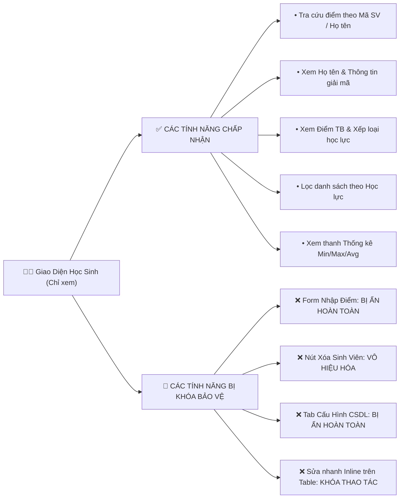

# 👨‍🎓 TÍNH NĂNG CHẾ ĐỘ HỌC SINH / SINH VIÊN (CHỈ XEM & TRA CỨU)
## 🎓 HỌC VIỆN CÔNG NGHỆ BƯU CHÍNH VIỄN THÔNG (PTIT)
**Dự án**: Hệ Thống Quản Lý Sinh Viên Truyền Bảng Mạng UDP & Bảo Mật Mã Hóa CSDL SQL

---

## 1. 📌 GIAO DIỆN BẢO VỆ CHẾ ĐỘ HỌC SINH (STUDENT SAFE MODE)

Chế độ **Học sinh / Sinh viên** là chế độ xem an toàn mặc định khi mở ứng dụng Client GUI. Toàn bộ các công cụ nhập và sửa dữ liệu của Giảng viên đều được **khóa và ẩn an toàn**:

---

## 2. 🎯 CÁC CHỨC NĂNG DÀNH CHO HỌC SINH TRUY CẬP

### 2.1. Tra Cứu Kết Quả Học Tập An Toàn
- **Tra cứu từ khóa**: Học sinh nhập từ khóa (Mã SV hoặc Họ tên) ➔ Nhấn `Tìm Kiếm` ➔ UDP Client gửi yêu cầu `SEARCH_STUDENTS` lên Server.
- **Hiển thị thông tin giải mã**: Dữ liệu phản hồi từ UDP Server chứa Họ tên và Điểm thi đã được giải mã hiển thị trực quan lên bảng.

---

### 2.2. Tra Cứu Phiếu Báo Điểm Chi Tiết Môn Học (Transcript Modal)
- Học sinh chọn dòng sinh viên trên bảng ➔ Nhấn nút **"Bảng Điểm Môn Học"** (hoặc double-click vào dòng).
- Cửa sổ Phiếu Báo Điểm Chi Tiết xuất hiện với logo PTIT:
  - Bảng điểm chi tiết 5 môn học: Lập Trình Mạng, Mã Hóa & An Toàn Thông Tin, Cơ Sở Dữ Liệu SQL, Cấu Trúc Dữ Liệu, Kỹ Năng Giao Tiếp.
  - Điểm Quá Trình (30%), Điểm Thi (70%), Điểm Tổng Kết hệ 10 và Điểm Chữ quy đổi (`A+`, `A`, `B+`...).

---

### 2.3. Bộ Giả Lập Điểm GPA Simulator & Dự Đoán Học Lực Mục Tiêu
- Nhấn nút **"Giả Lập GPA"** để mở công cụ hỗ trợ lập kế hoạch học tập.
- Chọn mục tiêu xếp loại mong muốn (Xuất sắc, Giỏi, Khá) và số tín chỉ môn tiếp theo.
- Hệ thống tự động tính toán điểm tối thiểu cần đạt ở các môn tới để đạt xếp loại mục tiêu.

---

### 2.4. Hướng Dẫn Chuyển Đổi Quyền Khi Là Giảng Viên
Nếu người dùng là Giảng viên/Giáo viên sử dụng ứng dụng:
1. Nhấp chuột vào nút **`🔒 Quyền: Học sinh (Bấm để Đăng nhập Giảng viên)`** ở góc phải thanh Header.
2. Nhập mật khẩu xác thực Giảng viên (Mặc định: `ptit123` hoặc `admin123`).
3. Giao diện sẽ tự động mở khóa toàn bộ các công cụ quản lý điểm và cấu hình CSDL.
