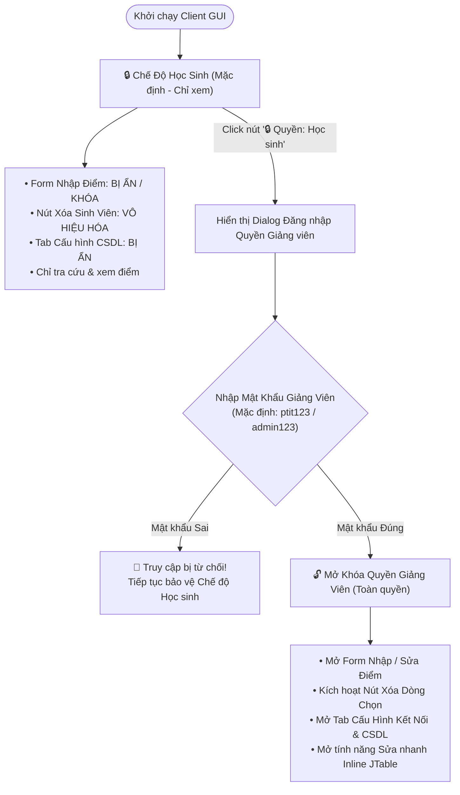

# 👩‍🏫 TÍNH NĂNG & BẢO VỆ PHÂN QUYỀN GIẢNG VIÊN (TEACHER ROLE SECURITY)
## 🎓 HỌC VIỆN CÔNG NGHỆ BƯU CHÍNH VIỄN THÔNG (PTIT)
**Dự án**: Hệ Thống Quản Lý Sinh Viên Truyền Bảng Mạng UDP & Bảo Mật Mã Hóa CSDL SQL

---

## 1. 🛡️ CƠ CHẾ BẢO VỆ TÍNH NĂNG CỦA GIẢNG VIÊN / GIÁO VIÊN

Hệ thống thiết lập cơ chế **Phân quyền và Bảo vệ Đăng nhập (Role-Based Authentication & Access Control)** nhằm đảm bảo Học sinh / Sinh viên không thể tự ý sửa đổi hoặc xóa điểm số thi:

---

## 2. 🎯 CÁC CHỨC NĂNG ĐƯỢC BẢO VỆ DÀNH RIÊNG CHO GIẢNG VIÊN

### 2.1. Xác Thực Mật Khẩu Bảo Mật Giảng Viên (Password Authentication)
- **Nút bảo vệ Role Badge**: Nút chuyển đổi vai trò `btnRoleAuth` được đặt ở vị trí nổi bật trên thanh Header màu đỏ PTIT.
- **Xác thực mật khẩu**: Khi người dùng muốn bật quyền Giảng viên, hệ thống yêu cầu nhập mật khẩu bảo mật (Mặc định: `ptit123` hoặc `admin123`).

- **Tự động Khóa bảo vệ**: Khi đăng xuất hoặc mở lại ứng dụng, hệ thống mặc định trở về Chế độ Học sinh (Chỉ xem) để đảm bảo an toàn dữ liệu.

---

### 2.2. Nhập / Sửa Hồ Sơ & Điểm Thi Sinh Viên (CRUD Workspace)
- **Form Nhập dữ liệu (`formPanel`)**: Chỉ xuất hiện và cho phép thao tác khi người dùng đã được xác thực Quyền Giảng viên thành công.
- **Badge chuyển sang màu xanh**: `🔓 Quyền: Giảng viên (Toàn quyền)`.
- **Tính năng Sửa nhanh Inline**: Click vào dòng sinh viên trên JTable sẽ tự động đổ thông tin lên Form để chỉnh sửa nhanh.

---

### 2.3. Quản Lý Xóa Dữ Liệu Sinh Viên (Delete Protected)
- **Nút Xóa dòng chọn (`btnDeleteSelected`)**: Nút màu đỏ sẫm PTIT kích hoạt cho phép xóa bản ghi sau khi xác nhận.
- **Kiểm soát thao tác**: Khi chưa đăng nhập Giảng viên, nút xóa bị vô hiệu hóa hoàn toàn.

---

### 2.4. Quản Lý Cấu Hình Kết Nối & CSDL (Settings Tab Protected)
- **Khóa Tab Cấu hình**: Tab *"Cấu hình Kết nối & CSDL"* bị ẩn hoàn toàn đối với Học sinh để ngăn chặn việc chỉnh sửa địa chỉ Server, tài khoản CSDL Supabase PostgreSQL hoặc H2 Embedded.
- **Mở khóa dành riêng cho Giảng viên**: Tab Cấu hình chỉ hiển thị lại sau khi Giảng viên xác thực mật khẩu thành công.
