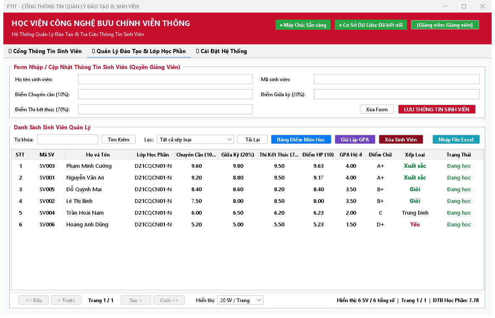

# PHÂN HỆ GIẢNG VIÊN & QUẢN LÝ ĐÀO TẠO TÍN CHỈ
## HỌC VIỆN CÔNG NGHỆ BƯU CHÍNH VIỄN THÔNG (PTIT)
**Dự án**: Hệ Thống Quản Lý Đào Tạo Tín Chỉ & Sinh Viên Qua Mạng RUDP 2.0

---

## 1. CƠ CHẾ PHÂN QUYỀN RBAC & BẢO VỆ CHỐNG BRUTE-FORCE

- **Xác thực Đa Vai Trò (RBAC):** Hệ thống phân tách 3 cấp độ quyền hạn tại cả tầng Giao diện và tầng Máy chủ `UDPServer`:
  - `HOCSINH`: Chỉ được phép tra cứu điểm và xuất phiếu điểm cá nhân. Mọi gói tin `ADD_STUDENT`, `UPDATE_STUDENT`, `DELETE_STUDENT`, `IMPORT_EXCEL` đều bị chặn tại Server.
  - `GIANGVIEN`: Được phép chấm điểm (`10% CC - 20% GK - 70% CK`), nhập/xuất danh sách Excel, xét học bổng & cảnh báo học vụ khi sổ điểm đang mở.
  - `ADMIN` (Phòng Giáo vụ): Toàn quyền hệ thống, có quyền **Khóa / Mở khóa sổ điểm học kỳ** và thanh tra lịch sử sửa điểm.
- **Chống Tấn Công Dò Mật Khẩu (`Brute-Force Protection`):** Nếu một tài khoản bị nhập sai mật khẩu 5 lần liên tiếp, `SessionManager` tự động khóa tài khoản đó trong 60 giây và ghi cảnh báo vào bảng `LichSuAudit`.

---

## 2. QUY CHẾ HỌC VỤ TÍN CHỈ THỰC TẾ TỰ ĐỘNG

Khi Giảng viên nhập hoặc cập nhật điểm thành phần của sinh viên, hệ thống tự động tính toán theo quy chế đào tạo tín chỉ đại học:

1. **Công thức trọng số học phần:**
   $$\text{Điểm Học Phần (10)} = 10\% \times \text{Chuyên Cần} + 20\% \times \text{Giữa Kỳ} + 70\% \times \text{Thi Kết Thúc}$$
2. **Xét Điều Kiện Dự Thi & Cấm Thi Tự Động:**
   - Nếu `Điểm Chuyên Cần < 5.0` $\rightarrow$ Tự động chuyển trạng thái **`Cấm thi (CC < 5.0)`**, quy đổi Điểm chữ **`F`** và `GPA Hệ 4 = 0.0`.
   - Nếu `Điểm Thi Kết Thúc < 4.0` (điểm liệt) $\rightarrow$ Tự động chuyển trạng thái **`Học lại (Thi < 4.0)`**, quy đổi Điểm chữ **`F`**.
3. **Phân Loại Cảnh Báo Học Vụ & Học Bổng Khuyến Khích Học Tập (KKHT):**
   - `GPA Hệ 4 < 1.20`: **Cảnh báo Mức 2** (Nguy cơ buộc thôi học).
   - `1.20 <= GPA Hệ 4 < 2.00`: **Cảnh báo Mức 1**.
   - `GPA Hệ 4 >= 3.20` (kèm `CC >= 8.0`, không điểm thành phần nào dưới `7.0`): **`Đạt Học Bổng KKHT`** (Phân loại Học bổng Xuất sắc 120% và Học bổng Giỏi 100%).
4. **Hội Đồng Xét Học Bổng & Xử Lý Học Vụ:**
   - Nhấn nút **`★ Học Bổng & Cảnh Báo`** trên thanh công cụ để mở bảng tổng hợp toàn trường và xuất riêng danh sách sinh viên nhận học bổng hoặc danh sách sinh viên bị cảnh báo học vụ ra file Excel `.xlsx`.
5. **Phân Trang Tải Gói Tin Mạng (`20 / 50 / 100 SV / Trang`):**
   - Tối ưu hóa băng thông UDP khi cơ sở dữ liệu mở rộng lên hàng nghìn sinh viên, hiển thị trực tiếp độ trễ mạng `RTT (ms)` và số lần truyền lại `ARQ Retry`.
