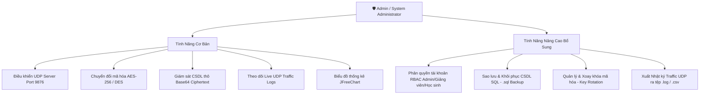

# 🛡️ TÍNH NĂNG PHÂN HỆ QUẢN TRỊ VIÊN / ADMIN (SERVER GUI)
## 🎓 HỌC VIỆN CÔNG NGHỆ BƯU CHÍNH VIỄN THÔNG (PTIT)
**Dự án**: Hệ Thống Quản Lý Sinh Viên Truyền Bảng Mạng UDP & Bảo Mật Mã Hóa CSDL SQL

---

## 1. 📌 TỔNG QUAN VÀ QUYỀN HẠN CỦA QUẢN TRỊ VIÊN (ADMIN)

Phân hệ **Quản trị viên / Admin** được vận hành trên ứng dụng Server GUI (`ServerGUI.java`), đóng vai trò điều khiển cổng lắng nghe UDP, cấu hình mã hóa CSDL và phân tích biểu đồ thống kê:

---

## 2. 🎯 CÁC CHỨC NĂNG CHI TIẾT DÀNH CHO ADMIN / SERVER GUI

### 2.1. Giám Sát CSDL Mã Hóa (Encrypted Data Inspection)
- Bảng đối chiếu hai chiều giữa **Dữ liệu thô đã mã hóa trong CSDL** (Base64 Ciphertext) và **Dữ liệu sau khi giải mã** (Decrypted Plaintext).
- Chứng minh dữ liệu cá nhân (Họ tên, Điểm thi) được bảo mật tuyệt đối an toàn trong CSDL SQL.

---

### 2.2. Biểu Đồ Thống Kê Học Lực Trực Quan (JFreeChart)
- Biểu đồ hình tròn (Pie Chart) tự động cập nhật phân bổ xếp loại học lực toàn trường:
  - 🥇 **Xuất sắc**: Điểm TB $\ge 9.0$ (Đỏ PTIT `#C8102E`)
  - 🥈 **Giỏi**: $8.0 \le$ Điểm TB $< 9.0$ (Xanh lá `#28A745`)
  - 📙 **Trung bình**: $5.0 \le$ Điểm TB $< 6.5$ (Cam `#FF9900`)

---

### 2.3. Toàn Cảnh Kết Nối Client - Server UDP Thời Gian Thực
- Khởi động đồng thời Server GUI và Client GUI qua mạng UDP đa luồng:

