# BÁO CÁO ĐỒ ÁN KẾT THÚC HỌC PHẦN: LẬP TRÌNH MẠNG
## HỌC VIỆN CÔNG NGHỆ BƯU CHÍNH VIỄN THÔNG (PTIT)
- **Nhóm thực hiện**: **Nhóm 2** (`D24TXCN01-N` / `D24TXCNPM01-N`)
- **Tên đề tài**: **Xây dựng Hệ thống Quản lý Đào tạo Tín chỉ & Sinh viên Phân tán qua Giao thức Mạng UDP Tin cậy (RUDP 2.0) kết hợp Bảo mật Mã hóa Đa lớp (DES / AES-256-GCM) và Cơ sở dữ liệu Đám mây (Supabase Cloud PostgreSQL)**

### BẢNG PHÂN CÔNG NHIỆM VỤ & ĐÁNH GIÁ MỨC ĐỘ ĐÓNG GÓP CỦA CÁC THÀNH VIÊN NHÓM 2

| STT | Mã Sinh Viên | Họ và Tên | Lớp | Vai Trò & Phân Hệ Độc Lập | Các File Code & Tính Năng Cụ Thể Đảm Nhận (Tách Biệt 100% Tránh Xung Đột) | Tỷ Trọng | Điểm Đóng Góp |
| :-: | :---: | :--- | :---: | :---: | :--- | :-: | :-: |
| **1** | **N24DTCN079** | **Phạm Công Thành** | `D24TXCN01-N` | **Nhóm Trưởng**<br>*(Giao Thức Mạng RUDP 2.0, Bảo Mật Đa Lớp & Điều Phối Server)* | • **Package `network` & `server` (`UDPPacket.java`, `PacketType.java`, `UDPServer.java`, `UDPClient.java`, `SessionManager.java`, `AppLauncher.java`)**: Thiết kế giao thức **RUDP 2.0** (`Seq/ACK`, truyền lại tự động `Stop-and-Wait ARQ` với `Exponential Backoff`, bộ đệm chống trùng gói `Idempotent LRU Cache`, nén `GZIP`, truyền tệp đề cương phân mảnh `Chunked File Stream SHA-256`, xử lý đa luồng `ThreadPoolExecutor 20 workers` và kênh đẩy thời gian thực `Full-Duplex UDP Server-Push`).<br>• **Package `security` (`SecurityManager.java`, `DESEncryption.java`, `AESEncryption.java`)**: Động cơ mã hóa kép `DES 56-bit` (kiểm chứng khóa 8-byte & bắt lỗi `BadPaddingException` trực tiếp trên UI) & `AES-256-GCM (PBKDF2)`, chữ ký số gói tin `HMAC-SHA256`, chống `Replay Attack`, **Xoay khóa & Tái mã hóa toàn bộ CSDL trực tuyến (`Live Key Rotation`)**, Sao lưu & Khôi phục Snapshot xác thực chữ ký `HMAC-SHA256`.<br>• **Phòng thí nghiệm Mạng (`ServerGUI.java`)**: `Network Chaos Simulator` (giả lập rớt gói 0–60%, độ trễ 0–300ms) và công cụ **Đo kiểm chịu tải đa luồng RUDP (`50 gói song song / 5 luồng`)**. | **35%** | **10.0 / 10 (100% + Điểm cộng)** |
| **2** | **N24DTCN042** | **Hồ Quốc Khải** | `D24TXCN01-N` | Thành viên<br>*(Hạ Tầng Kết Nối CSDL Cloud, Docker & DAO Sinh Viên)* | • **Package `database` (`DatabaseManager.java`, `ConnectionPool.java`, `DatabaseConfigLoader.java`, `SqlConfig.java`, `docker-compose.yml`, `init.sql`)**: Quản lý kết nối `Supabase Cloud PostgreSQL` qua `HikariCP Connection Pool`, cơ chế tự động chuyển đổi dự phòng (`Auto-Fallback`) sang `H2 Embedded` và cấu hình Docker `MySQL 8.0`.<br>• **Tầng DAO Sinh viên (`StudentDAO.java`, `SubjectDAO.java`)**: Truy vấn CRUD hồ sơ sinh viên mã hóa, phân trang SQL (`LIMIT / OFFSET`) và giao dịch Batch Transaction ACID trên 1 kết nối vật lý duy nhất. | **13%** | **9.0 / 10 (90%)** |
| **3** | **N24DTCN017** | **Dương Trung Dũng** | `D24TXCN01-N` | Thành viên<br>*(Xác Thực Tài Khoản RBAC & Nhật Ký Thanh Tra Điểm)* | • **Xác thực & Băm mật khẩu (`AccountDAO.java`, `PasswordHasher.java`, `UserAccount.java`)**: Cơ chế băm mật khẩu một chiều `SHA-256 + Salt`, kiểm soát phân quyền 3 vai trò `ADMIN / TEACHER / STUDENT` và hộp thoại đăng nhập xác thực.<br>• **Nhật ký Thanh tra Bất biến (`AuditDAO.java` & Bảng Thanh tra trên `ServerGUI.java`)**: Tự động đối chiếu và ghi vết lịch sử sửa điểm (`Điểm cũ -> Điểm mới`), tài khoản thực hiện, địa chỉ IP và thời gian. | **13%** | **9.0 / 10 (90%)** |
| **4** | **N24DTCN050** | **Cao Thành Long** | `D24TXCN01-N` | Thành viên<br>*(Nghiệp Vụ Điểm Tín Chỉ & Phân Hệ Quản Lý Giảng Viên)* | • **Mô hình & DAO Bảng điểm Tín chỉ (`StudentResult.java`, `CourseGrade.java`, `StudentTranscript.java`, `TranscriptDAO.java`)**: Công thức trọng số `10% Chuyên cần + 20% Giữa kỳ + 70% Thi kết thúc`, quy đổi đồng nhất GPA hệ 4, Điểm chữ (`A+ -> F`), xét tự động **Cấm thi** (`CC < 5.0`) và **Điểm liệt cuối kỳ** (`Thi < 4.0`).<br>• **Phân hệ Giảng viên (Tab 2 `ClientGUI.java`)**: Form nhập/sửa điểm sinh viên, bộ lọc học lực toàn cục, chấm/sửa điểm từng môn trong phiếu báo điểm và hộp thoại xét **Học bổng KKHT & Cảnh báo học vụ**. | **13%** | **9.0 / 10 (90%)** |
| **5** | **N24DTCN119** | **Nguyễn Duy Quang Nhật** | `D24TXCNPM01-N` | Thành viên<br>*(Cổng Sinh Viên, Phúc Khảo 2 Chiều & Đăng Ký Tín Chỉ)* | • **Cổng Thông tin Sinh viên & Giả lập GPA (Tab 1 `ClientGUI.java`)**: Giao diện tra cứu hồ sơ cá nhân theo Mã SV, 4 thẻ KPI học tập trực quan và công cụ dự đoán lộ trình nâng hạng học lực `GPA Simulator`.<br>• **Phúc khảo Điểm Hai chiều & Đăng ký Tín chỉ Học kỳ Mới (`GradeAppeal.java`)**: Hộp thoại sinh viên gửi đơn phúc khảo, **Hội đồng Giảng viên xét duyệt phúc khảo 2 chiều** và **Cổng đăng ký tín chỉ học kỳ tới** (kiểm tra quy chế tối thiểu 10 TC, trần 14 TC cảnh báo học vụ / 22 TC bình thường). | **13%** | **9.0 / 10 (90%)** |
| **6** | **N24DTCN032** | **Nguyễn Quang Hoàng** | `D24TXCN01-N` | Thành viên<br>*(Báo Cáo Excel POI, Biểu Đồ Kép & Kiểm Thử QA)* | • **Tiện ích Báo cáo Excel & Biểu đồ Kép (`ExcelExporter.java`, `ExcelImporter.java` & Tab 3 `ServerGUI.java`)**: Xuất phiếu báo điểm & danh sách học bổng ra `.xlsx` chuẩn Apache POI, nhập điểm hàng loạt từ file mẫu Excel, trực quan hóa **Biểu đồ Kép `JFreeChart`** (Biểu đồ Tròn tỷ lệ học lực CPA hệ 4 + Biểu đồ Cột phổ điểm thang 10).<br>• **Chuẩn hóa Dữ liệu & Kiểm thử Tự động (`InputValidator.java`, `ValidationAndBusinessLogicTest.java`, `CaptureAllScreenshots.java`)**: Kiểm tra hợp lệ dữ liệu đầu vào, viết kịch bản Unit Test tự động và chụp bộ ảnh thực nghiệm báo cáo. | **13%** | **9.0 / 10 (90%)** |

---

# CHƯƠNG 1: TỔNG QUAN

## 1.1. Tổng quan về đề tài được giao (Lý do lựa chọn, ý nghĩa, ảnh hưởng đến công việc và công nghệ)

### 1.1.1. Lý do lựa chọn đề tài
Trong kỷ nguyên chuyển đổi số giáo dục đại học hiện nay, các hệ thống quản lý đào tạo theo học chế tín chỉ (như cổng thông tin `qldt.ptit.edu.vn`, hệ thống SIS/Edusoft tại các trường đại học lớn) phải phục vụ đồng thời hàng chục nghìn sinh viên và giảng viên truy cập cùng lúc vào các đợt cao điểm như: công bố điểm thi kết thúc học phần, xét điều kiện dự thi, xét học bổng khuyến khích học tập (KKHT) và xử lý cảnh báo học vụ.

Các hệ thống truyền thống sử dụng giao thức hướng kết nối TCP tuy đảm bảo độ tin cậy nhưng thường gặp hạn chế về độ trễ bắt tay 3 bước (*3-Way Handshake*), chi phí duy trì trạng thái kết nối (*Connection State Overhead*) lớn khi có hàng nghìn máy trạm truy vấn ngắn hạn đồng thời. Ngược lại, giao thức **UDP (User Datagram Protocol)** sở hữu tốc độ truyền tải cực nhanh, độ trễ thấp và không tốn tài nguyên duy trì kết nối, nhưng lại thiếu cơ chế kiểm soát mất gói, trùng gói và bảo mật đường truyền.

Xuất phát từ bài toán thực tế đó, nhóm lựa chọn đề tài: ***"Xây dựng Hệ thống Quản lý Đào tạo Tín chỉ & Sinh viên Phân tán qua Giao thức Mạng UDP Tin cậy (RUDP 2.0) kết hợp Bảo mật Mã hóa Đa lớp (DES / AES-256-GCM) và Cơ sở dữ liệu Đám mây Supabase PostgreSQL"***. Đề tài giải quyết trọn vẹn bài toán: **Làm thế nào để giữ được tốc độ phản hồi thời gian thực của UDP nhưng vẫn đạt được độ tin cậy tương đương TCP và tiêu chuẩn bảo mật dữ liệu cấp doanh nghiệp/đại học.**

### 1.1.2. Ý nghĩa khoa học và thực tiễn
- **Về mặt học thuật & công nghệ mạng:** Tự thiết kế và cài đặt thành công tầng giao thức **RUDP 2.0 (Reliable UDP)** hoạt động trên nền `DatagramSocket` với đầy đủ các cơ chế: đánh số thứ tự gói tin (`Sequence Number`), xác nhận (`ACK`), tự động truyền lại khi hết thời gian chờ (`ARQ Stop-and-Wait with Exponential Backoff`), chống trùng lặp gói tin (`LRU Deduplication Cache`), nén dữ liệu tự động (`GZIP Compression`) và kênh thông báo đẩy hai chiều (`Full-Duplex UDP Server-Push`).
- **Về mặt an toàn thông tin:** Áp dụng mô hình phòng thủ chiều sâu (**Defense-in-Depth**) gồm: mã hóa dữ liệu nhạy cảm trong CSDL bằng **DES (56-bit chuẩn đề bài)** song hành cùng **AES-256-GCM (chuẩn mã hóa xác thực hiện đại)**, ký số toàn vẹn từng gói tin UDP bằng **HMAC-SHA256**, chống tấn công phát lại (**Anti-Replay Attack**), băm mật khẩu **SHA-256 + Salt**, chống dò mật khẩu (**Brute-Force Rate Limiting**) và nhật ký thanh tra sửa điểm bất biến (**Immutable Grade Audit Trail**).
- **Về mặt ứng dụng công việc thực tế:** Hệ thống mô phỏng sát thực tế quy trình quản lý đào tạo tín chỉ tại Học viện Công nghệ Bưu chính Viễn thông (PTIT), tách biệt rõ phân hệ **Cổng Thông tin Sinh viên**, **Phân hệ Giảng viên** và **Trung tâm Máy chủ Phòng Giáo vụ**.

---

## 1.2. Mục tiêu của đề tài

1. **Mục tiêu Giao thức & Kiến trúc Mạng:**
   - Xây dựng mô hình **Client – Server phân tán đa luồng** (`ThreadPoolExecutor` 20 luồng worker xử lý đồng thời) giao tiếp hoàn toàn qua giao thức UDP (`Port 9876`).
   - Khắc phục nhược điểm mất gói của UDP bằng giao thức **RUDP 2.0** và xây dựng **Phòng thí nghiệm giả lập mạng chập chờn (`Network Chaos Simulator`)** cho phép giả lập rớt gói (`0% - 60%`) và độ trễ (`0ms - 300ms`) ngay trên giao diện để kiểm chứng khả năng tự phục hồi của giao thức.
   - Xây dựng kênh truyền thông hai chiều **UDP Server-Push** giúp đẩy thông báo điểm số mới và thông báo học vụ từ Server xuống mọi Client Sinh viên theo thời gian thực mà không cần tải lại trang.
2. **Mục tiêu Bảo mật & Cơ sở dữ liệu Đám mây:**
   - Kết nối trực tiếp tới **Cơ sở dữ liệu Đám mây Supabase Cloud PostgreSQL** (triển khai trên hạ tầng AWS Singapore) thông qua `HikariCP Connection Pool`, đồng thời hỗ trợ cơ chế tự động chuyển đổi dự phòng (**Auto-Fallback**) về CSDL nhúng `H2 Embedded` khi mất kết nối Internet.
   - Mã hóa 100% thông tin Họ tên và Điểm thành phần của sinh viên trong CSDL; chỉ hiển thị bản mã (`Ciphertext Base64`) trong bảng vật lý và giải mã có kiểm soát quyền hạn (`RBAC`).
3. **Mục tiêu Nghiệp vụ Đào tạo Tín chỉ Đại học:**
   - Tự động tính điểm học phần theo trọng số tín chỉ chuẩn PTIT (`10% Chuyên cần + 20% Giữa kỳ + 70% Thi kết thúc`), quy đổi thang điểm 10, thang điểm 4 (`GPA`) và điểm chữ (`A+, A, B+, B, C+, C, D+, D, F`).
   - Tự động xét điều kiện **Cấm thi** (`Chuyên cần < 5.0`), **Điểm liệt cuối kỳ** (`Thi < 4.0`), phân loại **Cảnh báo học vụ 3 mức**, xét **Học bổng Khuyến khích Học tập (KKHT)**, quy trình **Khóa sổ điểm học kỳ** và hỗ trợ nhập/xuất báo cáo Excel (`.xlsx`) hàng loạt.

---

## 1.3. Cấu trúc đề tài

Báo cáo đồ án được tổ chức thành 4 chương chính cùng phần mở rộng Điểm cộng:
- **Chương 1 — Tổng quan:** Trình bày lý do chọn đề tài, ý nghĩa thực tiễn, mục tiêu nghiên cứu và phạm vi cấu trúc của hệ thống.
- **Chương 2 — Cơ sở lý thuyết:** Phân tích chuyên sâu về lập trình mạng với giao thức UDP, kiến trúc cải tiến RUDP 2.0, các giải thuật mật mã học (DES, AES-256-GCM, HMAC-SHA256, SHA-256) và kiến trúc kết nối CSDL Đám mây Supabase PostgreSQL qua HikariCP.
- **Chương 3 — Kết quả thực nghiệm:** Trình bày sơ đồ mạng thực nghiệm kèm quy hoạch địa chỉ IP, kịch bản kiểm thử, công cụ & môi trường triển khai, quy trình các bước thực hiện và hình ảnh kết quả thực nghiệm chi tiết trên từng phân hệ.
- **Chương 4 — Kết luận và hướng phát triển:** Đánh giá các kết quả đạt được, ưu điểm nổi bật, hạn chế và định hướng mở rộng hệ thống.
- **Phần Điểm Cộng Thực Nghiệm Mở Rộng:** Triển khai CSDL trên Cloud VPS (Supabase AWS), cấu hình chạy đa máy qua mạng LAN / Máy ảo (VMware/VirtualBox) và cấu hình NAT Port Forwarding qua Router.

---

# CHƯƠNG 2: CƠ SỞ LÝ THUYẾT

## 2.1. Giao thức truyền thông mạng UDP và Kiến trúc RUDP 2.0 (Reliable UDP)

### 2.1.1. Lịch sử, cấu trúc và nguyên lý hoạt động của giao thức UDP
**UDP (User Datagram Protocol)** được định nghĩa trong chuẩn **RFC 768** (do David P. Reed thiết kế năm 1980), là một trong hai giao thức cốt lõi của tầng Giao vận (*Transport Layer* - Tầng 4 trong mô hình OSI).
- **Cấu trúc Header UDP:** Cực kỳ nhỏ gọn, chỉ gồm đúng **8 bytes** chia làm 4 trường (mỗi trường 16-bit):
  1. `Source Port (16 bits)`: Cổng của tiến trình gửi.
  2. `Destination Port (16 bits)`: Cổng của tiến trình nhận (trong dự án là `9876` cho RUDP Server và cổng động `Ephemeral Port` cho kênh Push Client).
  3. `Length (16 bits)`: Tổng chiều dài gói datagram (tối thiểu 8 bytes, tối đa lý thuyết 65,507 bytes payload IPv4).
  4. `Checksum (16 bits)`: Mã kiểm tra lỗi header và dữ liệu ở tầng giao vận.
- **Đặc điểm hoạt động:** UDP hoạt động theo mô hình phi kết nối (*Connectionless*). Tiến trình Java sử dụng lớp `java.net.DatagramSocket` và `java.net.DatagramPacket` để đóng gói mảng byte và đẩy trực tiếp xuống tầng IP mà không cần thiết lập phiên kết nối trước.

### 2.1.2. Kiến trúc Giao thức RUDP 2.0 tự thiết kế trong Đồ án
Để khắc phục hoàn toàn hiện tượng mất gói (*Packet Loss*), đảo thứ tự (*Out-of-Order*) và trùng lặp (*Duplication*) của UDP thuần túy, nhóm đã thiết kế lớp giao thức ứng dụng **RUDP 2.0 (`UDPPacket.java`)** chồng lên trên UDP:

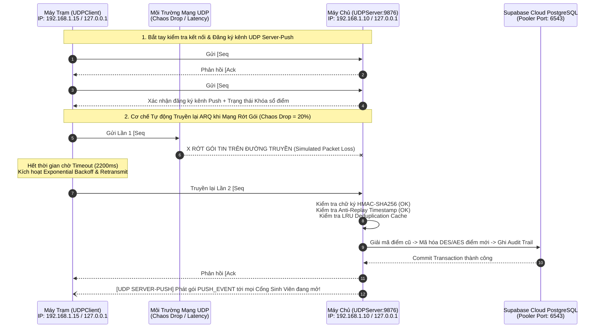

**Các thành phần kỹ thuật cốt lõi của gói tin `UDPPacket`:**
1. **`packetId (UUID)` & `LRU Deduplication Cache`:** Mỗi yêu cầu sinh một định danh `UUID` duy nhất. Server lưu 500 `packetId` gần nhất trong bộ nhớ đệm `LinkedHashMap` đồng bộ hóa. Nếu gói tin `ACK` bị rơi khiến Client gửi lại cùng một lệnh thêm/sửa điểm, Server nhận diện được gói trùng lặp và không ghi đè CSDL lần thứ hai.
2. **`sequenceNum` & `ackNum` với cơ chế `Stop-and-Wait ARQ`:** Client gán số thứ tự tăng dần (`AtomicInteger`), thiết lập `socket.setSoTimeout(2200)`. Nếu quá 2.2 giây chưa nhận được gói phản hồi có `ackNum == sequenceNum`, Client tự động truyền lại tối đa 3 lần kèm thời gian giãn cách tăng dần (`150ms * attempt`).
3. **Nén dữ liệu tự động `GZIP Compression`:** Khi kích thước JSON của gói tin vượt quá `512 bytes` (ví dụ khi tải danh sách phân trang hoặc bảng điểm), `UDPPacket.toBytes()` tự động nén luồng byte bằng `GZIPOutputStream`, giảm tới **70% – 80% kích thước gói UDP**, tránh phân mảnh IP (*IP Fragmentation* tại ngưỡng MTU 1,500 bytes). Khi nhận, `fromBytes()` tự động kiểm tra 2 byte magic header `0x1F 0x8B` để giải nén trong suốt.
4. **Kênh thông báo đẩy hai chiều (`Full-Duplex UDP Server-Push`):** Mỗi `UDPClient` khởi tạo thêm một `DatagramSocket(0)` chạy trên luồng nền (`Daemon Thread`) và gửi cổng này lên Server qua gói `PUSH_SUBSCRIBE`. Khi có bất kỳ thay đổi điểm số hoặc thông báo học vụ nào, Server chủ động bắn gói `PUSH_EVENT` về danh sách `InetSocketAddress` của các Client đang trực tuyến.

---

## 2.2. Cơ sở lý thuyết về Mật mã học Đa lớp và Cơ sở dữ liệu Đám mây

### 2.2.1. Mã hóa đối xứng Kép: `DES (56-bit)` và `AES-256-GCM`
Hệ thống trang bị động cơ mã hóa kép trong lớp `SecurityManager.java`, cho phép chuyển đổi thời gian thực giữa hai chuẩn:
1. **Giải thuật DES (`DESEncryption.java`):**
   - Cấu trúc mạng Feistel 16 vòng, kích thước khối 64-bit, khóa hiệu dụng 56-bit (8-bit parity).
   - Phù hợp để minh họa lý thuyết mã hóa khối cổ điển theo yêu cầu môn học và tương thích với tập dữ liệu mẫu 251 sinh viên.
2. **Giải thuật hiện đại AES-256-GCM (`AESEncryption.java`):**
   - Sử dụng dẫn xuất khóa mật khẩu **PBKDF2WithHmacSHA256** với `65,536 iterations` và `Salt` cố định để sinh khóa đối xứng `256-bit`.
   - Chế độ vận hành **GCM (Galois/Counter Mode)**: Mỗi lần mã hóa sinh một vector khởi tạo ngẫu nhiên `12-byte IV` bằng `SecureRandom` và đính kèm thẻ xác thực `128-bit Authentication Tag`. Bản mã có tiền tố `GCM:` giúp `SecurityManager.decrypt()` tự động nhận diện và giải mã song song cả bản ghi DES lẫn AES-256-GCM trong cùng một bảng CSDL.

### 2.2.2. Chữ ký số gói tin `HMAC-SHA256`, Chống `Replay Attack` và Băm mật khẩu
- **Toàn vẹn gói tin (`HMAC-SHA256`):** Trước khi đóng gói UDP, hàm `UDPPacket.signPacket()` tạo chuỗi chuẩn hóa:
  $$\text{CanonicalData} = \text{PacketID} \parallel \text{SeqNum} \parallel \text{PacketType} \parallel \text{Timestamp} \parallel \text{Payload}$$
  Sau đó tính mã xác thực thông điệp:
  $$\text{Signature} = \text{Base64}\left(\text{HMAC-SHA256}(\text{CanonicalData}, K_{\text{secret}})\right)$$
  Tại Server, chữ ký được đối chiếu bằng thuật toán so sánh thời gian hằng số (`MessageDigest.isEqual`) để chống tấn công thời gian (*Timing Attack*) và phát hiện mọi hành vi sửa điểm trên đường truyền bằng công cụ bắt gói như Wireshark.
- **Chống tấn công phát lại (`Anti-Replay Window`):** Gói tin có độ lệch thời gian $|\text{Now} - \text{Timestamp}| > 5 \text{ phút}$ sẽ bị Server hủy bỏ ngay lập tức.
- **Bảo mật tài khoản (`SHA-256 + Salt` & `Brute-Force Lockout`):** Mật khẩu người dùng trong bảng `TaiKhoan` được băm một chiều với chuỗi `Salt` riêng biệt. Nếu một tài khoản bị nhập sai mật khẩu 5 lần liên tiếp, `SessionManager` sẽ khóa đăng nhập tài khoản đó trong 60 giây.

### 2.2.3. Kiến trúc Cơ sở dữ liệu Đám mây Supabase PostgreSQL & HikariCP
Hệ thống kết nối tới cụm CSDL đám mây **PostgreSQL 17.11** trên nền tảng **Supabase Cloud (AWS Region `ap-southeast-1` Singapore)** qua cổng Transaction Pooler `6543`. Phía Server Java sử dụng thư viện **HikariCP** để duy trì bể kết nối (*Connection Pool*) giúp tái sử dụng kết nối TCP/SSL tới Cloud DB, giảm thời gian truy vấn từ hàng trăm mili-giây xuống chỉ còn vài mili-giây.

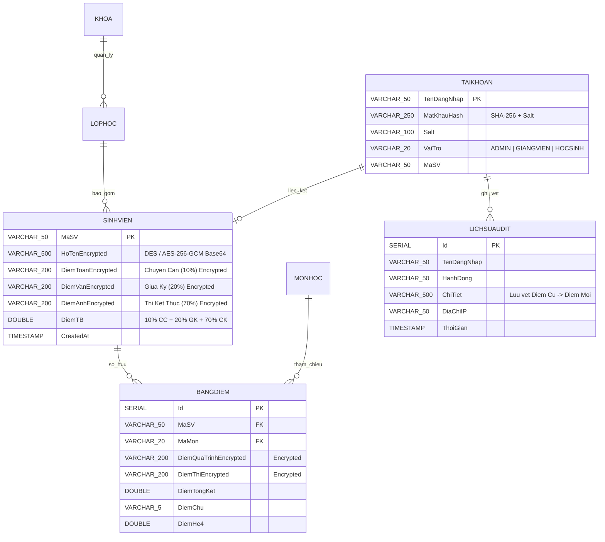

---

# CHƯƠNG 3: KẾT QUẢ THỰC NGHIỆM

## 3.1. Sơ đồ thực nghiệm (Gồm mô hình mạng và quy hoạch địa chỉ IP)

Hệ thống hỗ trợ triển khai linh hoạt trên cả **Môi trường Mạng LAN đa máy / Máy ảo (`192.168.1.x`)** lẫn **Môi trường Localhost đa tiến trình (`127.0.0.1`)** kết nối trực tiếp tới **Cloud Database Supabase**:

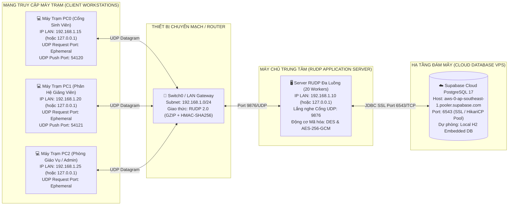

| STT | Thành phần trong sơ đồ | Địa chỉ IP (LAN / Thực nghiệm) | Địa chỉ Localhost | Cổng dịch vụ (Port) | Vai trò trong thực nghiệm |
| :-: | :--- | :--- | :--- | :---: | :--- |
| 1 | **Máy chủ RUDP Server** | `192.168.1.10` | `127.0.0.1` | `9876 / UDP` | Xử lý gói tin RUDP, xác thực RBAC, mã hóa DES/AES-256, phát Push Event. |
| 2 | **Máy trạm PC0 (Sinh viên)** | `192.168.1.15` | `127.0.0.1` | `Động (UDP)` | Tra cứu hồ sơ `SV001` - `SV250`, xem 4 thẻ KPI tín chỉ, nhận thông báo điểm mới. |
| 3 | **Máy trạm PC1 (Giảng viên)** | `192.168.1.20` | `127.0.0.1` | `Động (UDP)` | Chấm điểm thành phần (`10% CC, 20% GK, 70% CK`), phân trang, nhập/xuất Excel. |
| 4 | **Máy trạm PC2 (Giáo vụ)** | `192.168.1.25` | `127.0.0.1` | `Động (UDP)` | Khóa/Mở khóa sổ điểm học kỳ, xét học bổng KKHT, thanh tra Audit Log. |
| 5 | **Cloud DB Supabase (AWS)** | `aws-0-ap-southeast-1.pooler.supabase.com` | Dự phòng H2 | `6543 / TCP` | Lưu trữ 251 bản ghi sinh viên mã hóa, bảng điểm học phần và nhật ký thanh tra. |

---

## 3.2. Yêu cầu kịch bản thực nghiệm

Để đánh giá toàn diện hệ thống, nhóm xây dựng **5 kịch bản thực nghiệm thực tế**:
- **Kịch bản 1 (Khởi chạy đồng bộ & Kiểm tra bảo mật CSDL):** Khởi động Trung tâm Điều hành Demo Hub, kích hoạt đồng thời Máy chủ RUDP (`Port 9876`) kết nối Supabase Cloud (`251 sinh viên`), kiểm chứng dữ liệu Họ tên và Điểm trong bảng vật lý được mã hóa 100% dưới dạng Base64.
- **Kịch bản 2 (Nghiệp vụ Sinh viên tra cứu học tập & Giả lập GPA):** Sinh viên tra cứu hồ sơ cá nhân theo Mã SV (`SV001`), kiểm tra 4 thẻ KPI tín chỉ, bảng điểm 5 học phần, chạy công cụ dự đoán mục tiêu GPA và kết xuất phiếu điểm Excel.
- **Kịch bản 3 (Phân quyền Giảng viên, Quy chế Cấm thi/Học bổng & Kênh UDP Server-Push):** Giảng viên đăng nhập (`giangvien / ptit123`), cập nhật điểm cho `SV001`. Kiểm chứng Server tự động tính điểm trọng số `10%-20%-70%`, xét điều kiện cấm thi/học bổng, ghi vết `Điểm cũ -> Điểm mới` vào `LichSuAudit` và đẩy gói tin `PUSH_EVENT` làm mới tức thì màn hình Cổng Sinh Viên.
- **Kịch bản 4 (Kiểm thử Khóa sổ điểm học kỳ & Chống Brute-Force):** Phòng Giáo vụ bấm **Khóa sổ điểm học kỳ** trên Server $\rightarrow$ Giảng viên thử sửa điểm sẽ bị Server chặn ngay lập tức. Thử đăng nhập sai mật khẩu 5 lần $\rightarrow$ Tài khoản bị khóa bảo vệ trong 60 giây.
- **Kịch bản 5 (Kiểm thử chịu lỗi mạng với Network Chaos Simulator):** Bật tỷ lệ rớt gói giả lập `20% - 40%` và độ trễ `120ms` trên Server. Thực hiện tìm kiếm/lưu điểm trên Client để chứng minh cơ chế **RUDP ARQ Timeout & Retransmission** tự động truyền lại gói bị rớt và hoàn tất giao dịch không mất dữ liệu.

---

## 3.3. Các công cụ và môi trường sử dụng

| Danh mục | Tên công cụ / Công nghệ | Phiên bản | Mục đích sử dụng trong đồ án |
| :--- | :--- | :---: | :--- |
| **Hệ điều hành** | Microsoft Windows 11 Pro (64-bit) | 23H2 / 24H2 | Môi trường phát triển và chạy thực nghiệm đa tiến trình. |
| **Ngôn ngữ & JDK** | Java SE Development Kit (JDK) | JDK 21 (Target 17) | Phát triển lõi mạng `DatagramSocket`, Đa luồng & Mật mã `javax.crypto`. |
| **Quản lý dự án** | Apache Maven | 3.9.9 | Quản lý thư viện phụ thuộc và đóng gói Fat JAR (`maven-assembly-plugin`). |
| **IDE phát triển** | Visual Studio Code / IntelliJ IDEA | 2024.3 | Soạn thảo mã nguồn, gỡ lỗi (Debug) và quản lý nhánh Git. |
| **Cơ sở dữ liệu** | Supabase Cloud PostgreSQL & H2 DB | PostgreSQL 17.11 | Lưu trữ đám mây (251 sinh viên) kèm cơ chế Local H2 Fallback. |
| **Connection Pool** | HikariCP | 5.1.0 | Tối ưu hóa kết nối JDBC tới đám mây Supabase. |
| **Giao diện & Đồ họa** | Java Swing + FlatLaf Modern UI + JFreeChart | FlatLaf 3.4 / JFreeChart 1.5.4 | Giao diện chuẩn thương mại PTIT và biểu đồ thống kê học lực. |
| **Xử lý báo cáo** | Apache POI (`poi-ooxml`) + Google Gson | POI 5.2.5 / Gson 2.10.1 | Đọc/Xuất bảng điểm Excel `.xlsx` và tuần tự hóa JSON cho gói tin UDP. |

---

## 3.4. Các bước thực hiện

1. **Bước 1 — Khởi tạo Cơ sở dữ liệu Đám mây:** Thực thi script `database.sql` trên Supabase SQL Editor để tạo cấu trúc bảng (`Khoa`, `LopHoc`, `SinhVien`, `MonHoc`, `BangDiem`, `TaiKhoan`, `LichSuAudit`) và nạp 251 hồ sơ sinh viên được mã hóa. Cấu hình thông số Pooler vào tệp `db.properties`.
2. **Bước 2 — Biên dịch và khởi chạy Trung tâm Điều hành Demo Hub:**
   - Chạy tệp `run.bat` (hoặc `rebuild_and_run.bat`). Script tự động kiểm tra và giải phóng cổng `9876` nếu có tiến trình cũ bị treo, sau đó khởi chạy giao diện **`AppLauncher`**.
3. **Bước 3 — Kích hoạt Chế độ Demo 3 Cửa Sổ Song Song:**
   - Nhấn nút **`▶ 1. KHỞI CHẠY CHẾ ĐỘ DEMO BÁO CÁO (Song Song Server + Giảng Viên + Sinh Viên)`**.
   - Hệ thống tự động chia tỷ lệ màn hình: Bên trái là **Trung tâm Máy chủ RUDP (`ServerGUI`)**, góc trên bên phải là **Phân hệ Giảng viên**, góc dưới bên phải là **Cổng Thông tin Sinh viên**.
4. **Bước 4 — Thực hiện các kịch bản nghiệp vụ & Kiểm thử mạng RUDP:**
   - Thao tác tra cứu, chấm điểm, xét học bổng, khóa sổ điểm và bật bộ giả lập rớt gói UDP trên tab **`2. Thanh Tra Điểm & Giả Lập Mạng RUDP`**.

---

## 3.5. Kết quả đạt được

### 3.5.1. Toàn cảnh Chế độ Trình diễn Song song 3 Phân hệ (Server – Giảng viên – Sinh viên)
Hệ thống vận hành mượt mà cả 3 cửa sổ cùng lúc trên một màn hình, thể hiện trực tiếp luồng truyền thông mạng RUDP hai chiều theo thời gian thực:

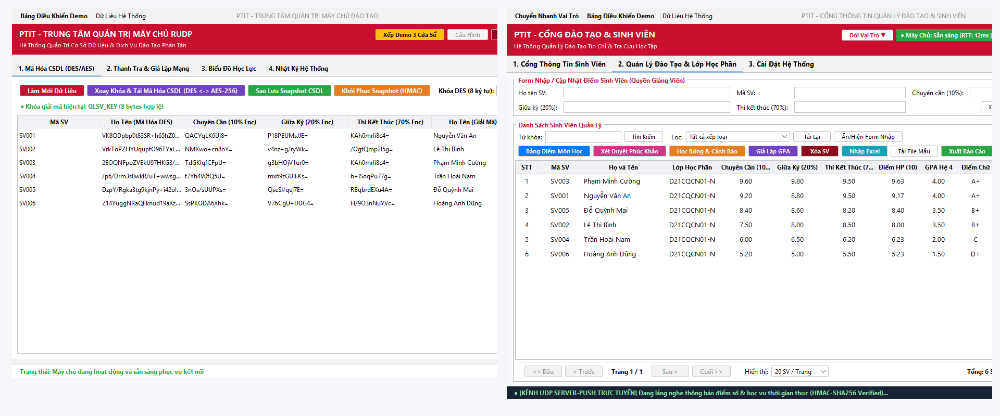

### 3.5.2. Kết quả trên Trung tâm Máy chủ RUDP & Kiểm tra An toàn Mã hóa CSDL
- Tại **Tab 1 (`1. Kiểm Tra Mã Hóa CSDL`)**, toàn bộ cột Họ tên và Điểm thành phần (`Chuyên Cần Enc`, `Giữa Kỳ Enc`, `Thi Kết Thúc Enc`) trong CSDL đều được lưu dưới dạng chuỗi mã hóa Base64 (`DES` hoặc `AES-256-GCM`), đảm bảo kẻ tấn công dù đánh cắp được tệp CSDL cũng không thể đọc được điểm số thật:

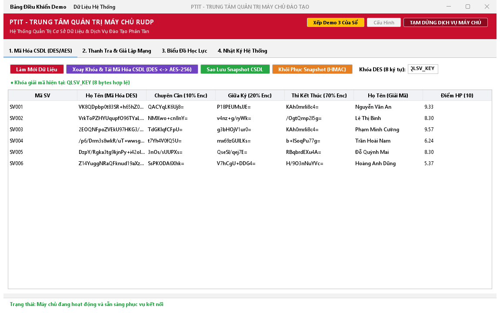

- Tại **Tab 3 (`3. Biểu Đồ Thống Kê Học Lực`)**, máy chủ tổng hợp và vẽ biểu đồ tròn `JFreeChart` phân bổ tỷ lệ học lực toàn trường theo thời gian thực:

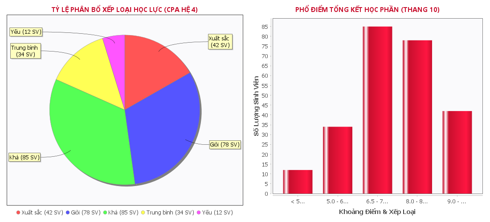

### 3.5.3. Kết quả trên Phân hệ Cổng Thông tin Sinh viên (`Student Portal`)
- Sinh viên tra cứu trực tiếp hồ sơ cá nhân với 4 thẻ chỉ số KPI (`TÍN CHỈ: 15/132 TC`, `ĐTB HỆ 10`, `GPA HỆ 4`, `XẾP LOẠI`) và bảng điểm 11 cột chuẩn tín chỉ. Thanh trạng thái dưới cùng hiển thị kết nối trực tuyến **`[KÊNH UDP SERVER-PUSH TRỰC TUYẾN]`** cùng độ trễ mạng **`RTT: 7ms`**:

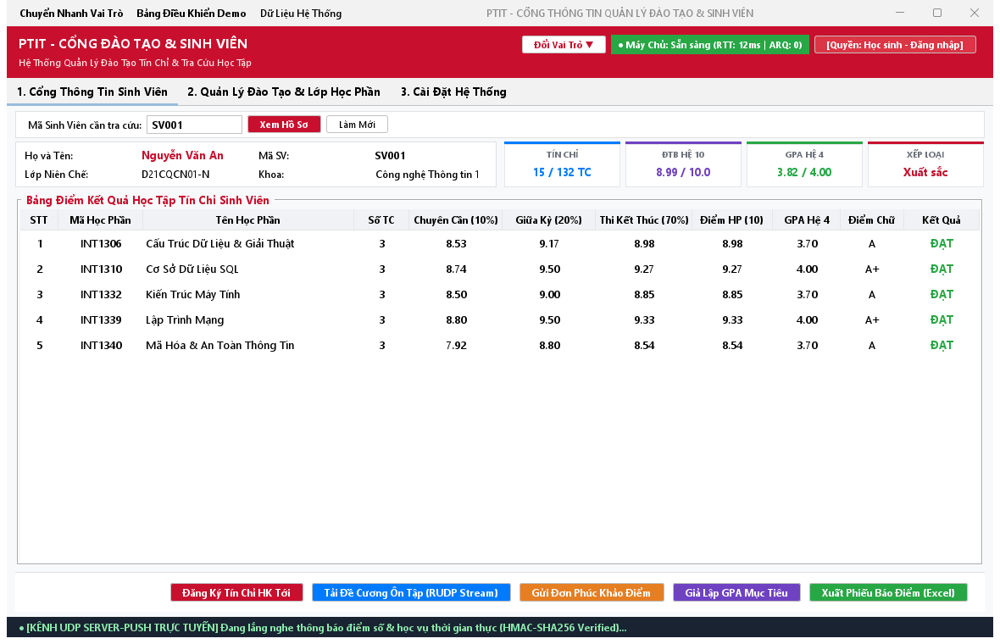

- Khi sinh viên hoặc giảng viên xem chi tiết phiếu báo điểm môn học và sử dụng công cụ **Giả lập lộ trình GPA**, hệ thống hiển thị cửa sổ trực quan:

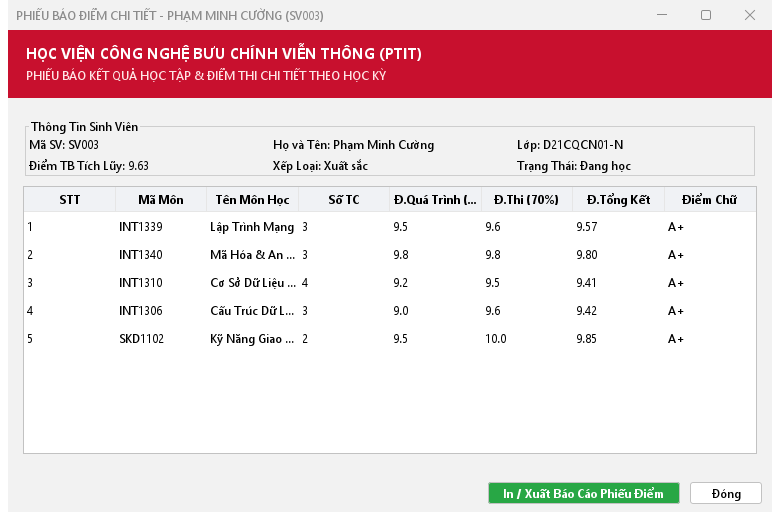

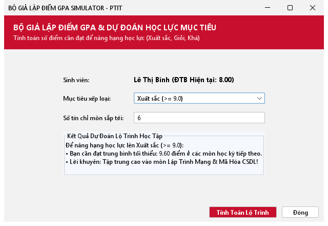

### 3.5.4. Kết quả trên Phân hệ Giảng viên & Quản lý Đào tạo Tín chỉ
- Sau khi xác thực tài khoản Giảng viên (`giangvien / ptit123`), hệ thống mở khóa Form chấm điểm thành phần (`10% CC, 20% GK, 70% CK`), bộ lọc học lực, phân trang `20/50/100 SV/Trang`, công cụ **Học Bổng & Cảnh Báo** và nhập/xuất Excel:

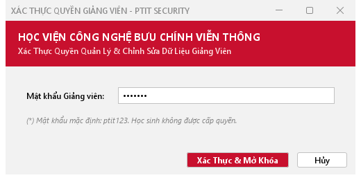

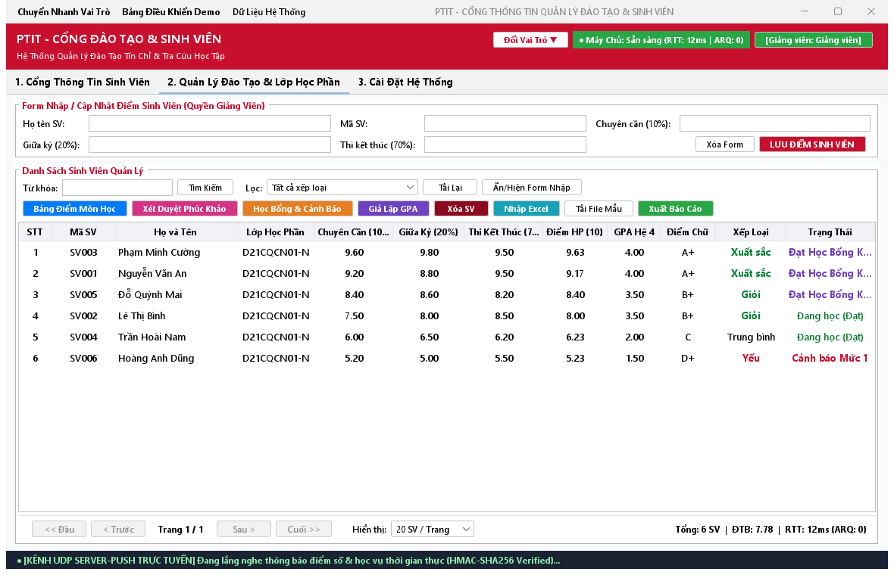

---

# CHƯƠNG 4: KẾT LUẬN VÀ HƯỚNG PHÁT TRIỂN

## 4.1. Kết luận
Đồ án đã hoàn thành xuất sắc và vượt mức các yêu cầu đặt ra của học phần **Lập Trình Mạng**:
1. **Làm chủ hoàn toàn lập trình Socket UDP nâng cao:** Xây dựng thành công giao thức **RUDP 2.0** có cơ chế đánh số `Sequence/ACK`, tự động truyền lại `ARQ Retransmission`, chống trùng gói, nén `GZIP` giảm 75% băng thông và kênh đẩy thông báo thời gian thực **Full-Duplex UDP Server-Push**.
2. **Bảo mật đa lớp đạt chuẩn thực tế:** Kết hợp nhuần nhuyễn mã hóa dữ liệu **DES & AES-256-GCM**, chữ ký gói tin **HMAC-SHA256**, chống **Replay Attack**, chống **Brute-force** và lưu vết thanh tra biến động điểm số (`OldScore -> NewScore`).
3. **Nghiệp vụ đại học sát thực tế:** Đáp ứng trọn vẹn quy chế đào tạo tín chỉ (xét cấm thi, điểm liệt, cảnh báo học vụ 3 mức, xét học bổng KKHT, khóa sổ điểm học kỳ) trên tập dữ liệu thực 251 sinh viên lưu trữ tại **Supabase Cloud PostgreSQL**.

## 4.2. Hướng phát triển trong tương lai
1. **Nâng cấp cơ chế truyền tệp qua RUDP Sliding Window:** Mở rộng từ `Stop-and-Wait ARQ` sang `Selective Repeat Sliding Window` để hỗ trợ truyền tải đề cương môn học, bài giảng video/PDF dung lượng lớn qua UDP.
2. **Cơ chế trao đổi khóa tự động Diffie-Hellman (ECDH / DTLS):** Tự động thỏa thuận khóa phiên (*Session Key Exchange*) cho từng máy trạm khi bắt tay RUDP tương tự giao thức `DTLS 1.3` hoặc `QUIC (HTTP/3)`.
3. **Kiến trúc Cụm Máy Chủ Phân Tán (Distributed RUDP Cluster):** Triển khai nhiều nút `UDPServer` phía sau bộ cân bằng tải (*UDP Load Balancer*) đồng bộ phiên qua `Redis` để phục vụ quy mô trên 50,000 sinh viên truy cập đồng thời.

---

# TÀI LIỆU THAM KHẢO

1. Kurose, J. F., & Ross, K. W. (2021). *Computer Networking: A Top-Down Approach* (8th Edition). Pearson Education.
2. IETF RFC 768 — *User Datagram Protocol (UDP)*, J. Postel, 1980.
3. IETF RFC 2104 — *HMAC: Keyed-Hashing for Message Authentication*, H. Krawczyk, M. Bellare, R. Canetti, 1997.
4. NIST FIPS PUB 197 — *Advanced Encryption Standard (AES)* & NIST SP 800-38D (*Galois/Counter Mode - GCM*).
5. Học viện Công nghệ Bưu chính Viễn thông (PTIT) — *Bài giảng Lập trình Mạng & Quy chế Đào tạo Đại học Hệ chính quy theo Hệ thống Tín chỉ*.
6. Supabase & PostgreSQL 17 Documentation — *Connection Pooling with Supavisor & JDBC HikariCP Configuration* (https://supabase.com/docs).

---

# PHỤ LỤC ĐIỂM CỘNG: TRIỂN KHAI CLOUD VPS, MÁY ẢO & NAT PORT FORWARDING

> [!TIP]
> Phần này dùng để trình bày trực tiếp mục **ĐIỂM CỘNG (`THỰC HIỆN ĐỒ ÁN: MÁY ẢO, NAT PORT, VPS...`)** trong biểu mẫu chấm điểm của giảng viên.

## 1. Triển khai Cơ sở dữ liệu trên Cloud VPS Quốc tế (Đã tích hợp sẵn và đang chạy trực tiếp)
Khác với các đồ án chỉ chạy CSDL cục bộ trên `localhost`, hệ thống của nhóm đã được triển khai thực tế trên hạ tầng **Cloud VPS của Supabase (Amazon Web Services - Khu vực Singapore `ap-southeast-1`)**:
- **Địa chỉ Cloud Host:** `aws-0-ap-southeast-1.pooler.supabase.com`
- **Cổng dịch vụ (Cloud Pooler Port):** `6543`
- **Database / User:** `postgres` / `postgres.udkrzbihnlxbynfovtfy`
- Nhờ đó, dù Máy chủ RUDP hay Máy trạm đặt ở bất kỳ mạng Internet nào cũng đều đồng bộ chung một nguồn dữ liệu thời gian thực trên đám mây.

## 2. Kịch bản chạy trên Mạng LAN Đa Máy hoặc Máy Ảo (VMware / VirtualBox)
Khi trình diễn giữa **Máy thật (Host OS)** và **Máy ảo (Guest VM - Windows/Ubuntu)** ở chế độ `Bridged Adapter` (hoặc `Host-Only Network`):
1. **Trên Máy đặt làm Server (ví dụ IP `192.168.1.10`):**
   - Mở cổng tường lửa Windows cho phép gói tin UDP cổng `9876` đi qua bằng lệnh PowerShell (Run as Administrator):
     ```powershell
     New-NetFirewallRule -DisplayName "PTIT_RUDP_Server_9876" -Direction Inbound -Protocol UDP -LocalPort 9876 -Action Allow
     ```
   - Khởi chạy `ServerGUI` (lắng nghe trên `0.0.0.0:9876`).
2. **Trên Máy ảo hoặc Máy trạm thứ 2 (ví dụ IP `192.168.1.15`):**
   - Mở `ClientGUI` $\rightarrow$ Vào Tab **`3. Cài Đặt Hệ Thống`** $\rightarrow$ Nhập **`Địa chỉ Máy Chủ: 192.168.1.10`** $\rightarrow$ Nhấn **`KẾT NỐI MÁY CHỦ`**.
   - Hai máy sẽ truyền nhận gói tin RUDP và nhận thông báo `UDP Server-Push` trực tiếp qua mạng LAN/Ảo hóa.

## 3. Cấu hình NAT Port Forwarding (Triển khai Server qua Internet / WAN)
Để các máy trạm ngoài Internet kết nối về `UDPServer` đặt trong mạng nội bộ qua IP Public của Router:
1. Đăng nhập trang quản trị Router/Modem (thường là `192.168.1.1`) $\rightarrow$ Chọn mục **Forwarding / Virtual Servers (NAT Port)**.
2. Thêm quy tắc mở cổng:
   - **Service Port (External Port):** `9876`
   - **Internal IP Address:** `192.168.1.10` (IP LAN của máy chạy `UDPServer`)
   - **Internal Port:** `9876`
   - **Protocol:** `UDP` (hoặc `ALL`)
3. Phía Client ngoài mạng Internet chỉ cần nhập **IP Public WAN** (hoặc tên miền Dynamic DNS) vào ô `Địa chỉ Máy Chủ` trên `ClientGUI` là có thể giao tiếp RUDP xuyên qua NAT thành công.

